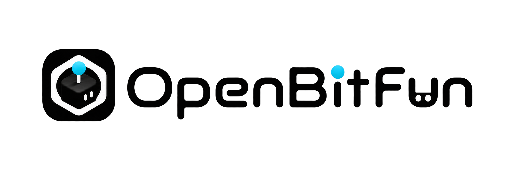
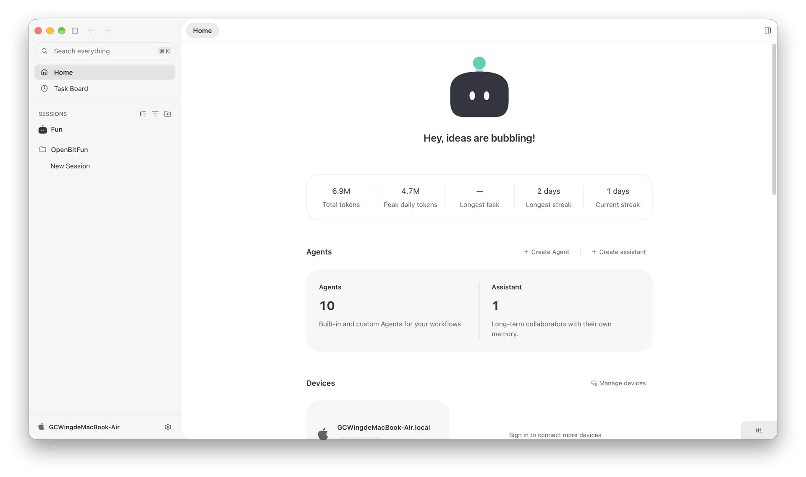
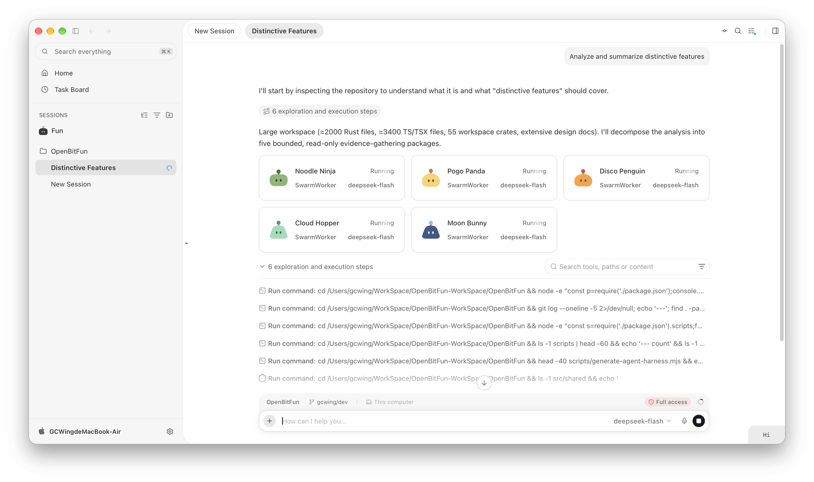
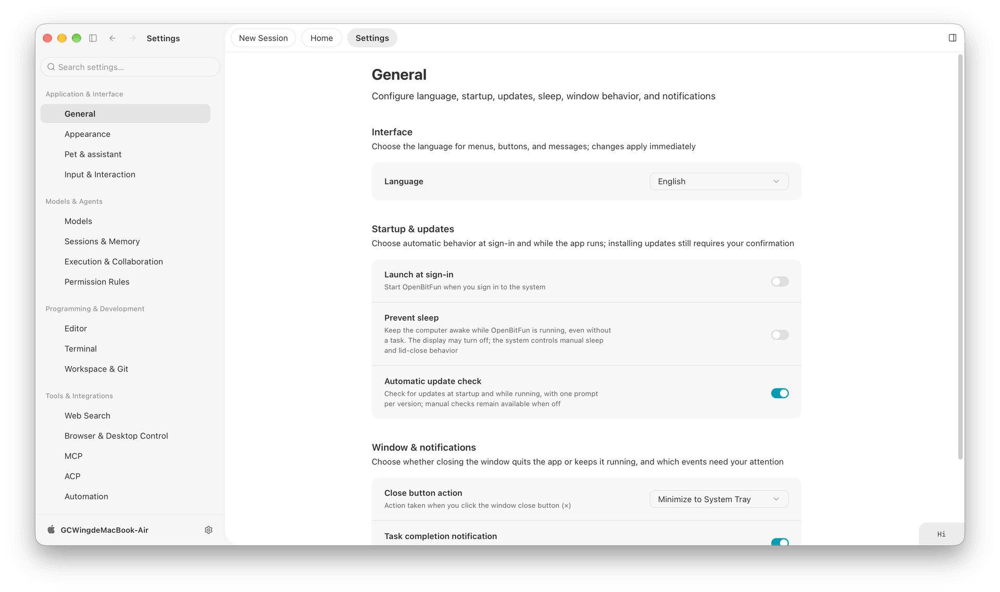
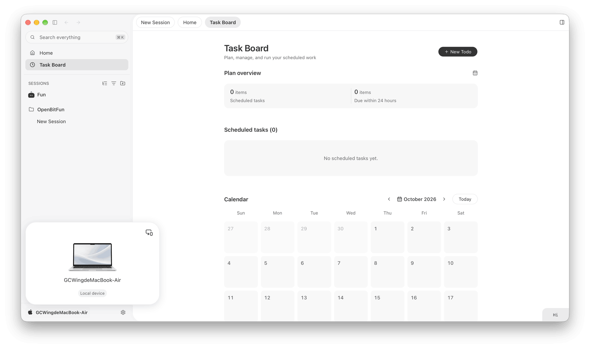
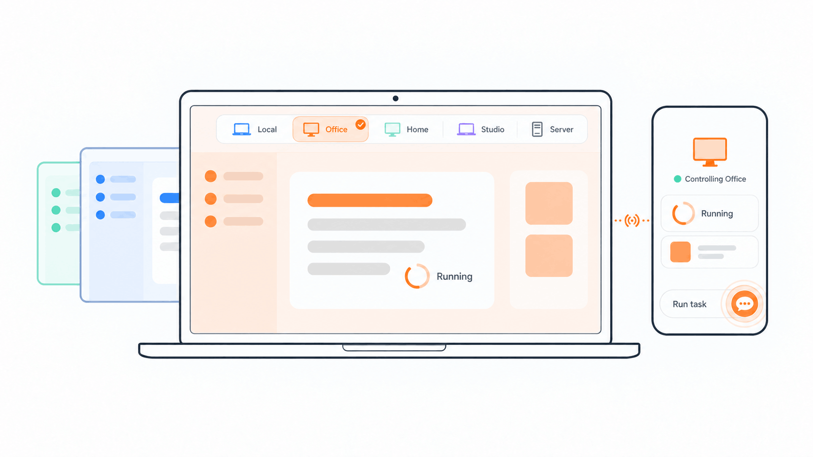
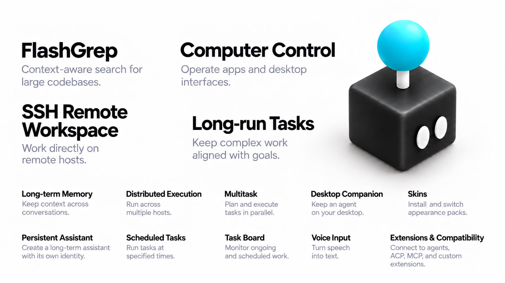

[English](README.md) · [中文](README.zh-CN.md) · **日本語**

<div align="center">



### 止まらずに進み続けるために。

OpenBitFun は、高度にカスタマイズできるオープンソースのエージェントワークスペースで、あなたのやり方で仕事を進め続けます。

**強力な 4 つの Agent Harness モード** · **デバイスをまたいだリモート操作** · **Mini App からソースコードまでのカスタマイズ**

**これがあなたの求めるエージェントワークスペースなら、OpenBitFun に ⭐ Star を付けて、より多くの人が見つけられるよう手伝ってください。**

[デスクトップ版をダウンロード](https://openbitfun.com/download) · [モバイル版のリリース](https://github.com/GCWing/OpenBitFun/releases?q=mobile-&expanded=true) · [Mini App マーケットプレイス](https://market.openbitfun.com/miniapp/) · [コミュニティに参加](#コミュニティに参加) · [コントリビュート](./CONTRIBUTING.md)

[](https://openbitfun.com/)
[](./LICENSE)
[](https://openbitfun.com/download)

[](https://trendshift.io/repositories/44672)

</div>

---

<div align="center">
  <video src="https://github.com/user-attachments/assets/ff1780fa-d248-40f1-9582-82e0de3d2f46" controls width="800"></video>
</div>

---

<p align="center">
  
  
  <br />
  
  
</p>

## あなたの働き方に合わせた 4 つのモード

**Agent Harness が、タスクの進め方を形作ります。** 手順を計画し、コンテキストを管理し、ツールを呼び出し、エージェントを調整し、その結果をまとめます。タスクに合ったモードを選んでください：


| モード | 使いどころ |
| --- | --- |
| **Minimal** | **手早い協働。** 明確な目標から始めます。エージェントが直接動き、あなたがフィードバックを返し、いっしょに作業を磨いていきます。 |
| **Standard** | **日常のタスク。** いくつかの手順がある作業向けです：進め方を計画し、それに沿って作業し、結果を確認します。 |
| **Ultimate** | **複雑なタスク。** 手ごわい問題を掘り下げ、作業をエージェントに分担させ、その結果をまとめます。 |
| **Creative** | **創作とカスタマイズ。** Mini App を作ったり、OpenBitFun のインターフェースや機能を拡張したりして、ワークスペースを自分のものにします。 |

## コンピューターを切り替え、スマートフォンから操作する

**デバイスを切り替えれば、ワークスペース全体が切り替わります。** デスクトップアプリで接続済みの別のコンピューターを選ぶと、インターフェースがそのデバイスのセッション、ワークスペース、ファイル、タスクの状態に切り替わります。自宅のコンピューター、職場のコンピューター、サーバーの間を、同じアプリで行き来できます。

**スマートフォンがリモコンになります。** スマートフォンやブラウザーから、指示を送り、進捗を確認し、承認の依頼に応えられます。タスクは選んだホストで動き、表示を切り替えたりリモコン側の接続を切ったりしても続きます。

**公式の Relay はすぐに使え、サーバーをデプロイする必要はありません。** 同じ OpenBitFun アカウントで、対応していれば GitHub かメールの確認コードを使って、各デバイスでサインインします。同じネットワーク内での接続も使えます。ログイン、インターネットへのアクセス、セルフホストの要件については、[接続の FAQ](./src/apps/relay-server/FAQ.md) を参照してください。

**モバイルでは、1 画面、2 画面、3 画面のレイアウトを切り替えられます。** 1 画面で会話に集中し、スマートフォンを開けば会話とファイルを並べて見られます。画面のレイアウトが変わると、インターフェースもそれに合わせて変わります。



<details>
<summary>接続とデプロイの詳細</summary>

SSH を使って、リモートのホストや、踏み台サーバーの先、あるいはコンテナーの中で作業できます。ファイルへのアクセス、ターミナル、ワークスペースのコマンドはその環境に向けられ、Agent Runtime は OpenBitFun のホストにとどまります。デスクトップアプリと CLI は中核となる実行の機能を共有し、モバイルのクライアントやメッセージングのボットは、タスクを操作する手段を増やします。

同じアカウントでのデバイスの操作には、デフォルトで公式の Relay を使います。デスクトップ版では、同じネットワーク内でのモバイルからの操作のために、ローカルの Relay を動かすこともできます。どちらの経路もサインインにはオンラインの OpenBitFun の ID サービスを使うので、LAN モードはオフラインでログインするための手段ではありません。独自の Relay には、それに合わせたクライアントのビルドが必要です：[デプロイのガイド](./src/apps/relay-server/README.md#for-community-developers-and-forks)を参照してください。

デバイス間のペイロードは、デバイス上で生成した鍵でエンドツーエンドで暗号化されます。セッションとファイルは、必要なときに、それを持つオンラインのデバイスから読み込まれます。Relay は引き続き、アカウント、デバイス、ルーティングのメタデータを扱います。これは、モデルのプロバイダー、メッセージングのボット、公開した Pages への通信には当てはまりません。[プライバシーの境界](./src/apps/relay-server/FAQ.md#what-can-the-services-see)、[Remote Connect](./docs/interactive-capabilities/capabilities/feature.remote-connect.md)、[リモートのワークスペース](./docs/features/remote-workspaces.md)を参照してください。

</details>

## 日々のニーズを役に立つアプリに

リポジトリ用の Git の分析パネル、プレゼンテーション用のワークスペース、決まった操作をまとめたフォームなどを作れます。**Mini App は、具体的なニーズを使えるツールに変えます。**

必要なものを説明すれば、エージェントがそれを作ります。どの Mini App も、専用のインターフェースとエージェントとの会話が対になっているので、日々の作業でアプリを使いながら、チャットで改良を続けられます。

作ったアプリはインストールして再利用でき、[Mini App マーケットプレイス](https://market.openbitfun.com/miniapp/)で自分の仕事に合ったツールを探すこともできます。

## OpenBitFun で OpenBitFun を拡張する

**役割、ツール、インターフェース、ソースコードをカスタマイズできます。** 自分の仕事に合ったエージェントから始めて、そのまわりにワークスペースを広げていきましょう：

- **専門のエージェントを作る。** モデルを選び、役割を定め、モーションコミックの制作、ビジュアルデザイン、コードレビュー、あるいはあなた自身の分野に必要なツールとワークフローを持たせます。
- **ツールとワークフローをつなぐ。** MCP でツールをつなぎ、繰り返す手順を Skills にし、Hooks を使ってタスクの動き方をカスタマイズします。
- **インターフェースとソースを変える。** [スキン](https://market.openbitfun.com/skin/)をインストールして見た目を変えたり、UI、ツール、ランタイムのソースを変更して、自分だけの OpenBitFun を作ったりできます。

**OpenBitFun の Code Agent に、OpenBitFun そのものの変更や拡張を頼むこともできます。**

[エージェントの管理](./docs/interactive-capabilities/capabilities/feature.agents.md)、[Hooks と互換性](./docs/features/agent-hooks.md)、[プロダクトのアーキテクチャ](./docs/architecture/product-architecture.md)についても、詳しく見てみてください。

## 長く続く作業のために

Rust の Agent Runtime が、セッションの状態、コンテキスト、ツールの実行を管理します。永続的なセッション、中断からの回復、長期記憶、長時間のタスクへの対応が、作業を進め続ける助けになります。コンテキストの圧縮とキャッシュの再利用が、長い実行でのリソースの消費を抑えます。

この **DeepSWE v1.1** の評価で、OpenBitFun は次の結果を出しました：

- **GLM-5.3-Flash**：合格率 **64.6%**、実行時間の中央値 **42.9 分**（P50）。
- **DeepSeek-V4-Flash**：合格率 **56.6%**、実行時間の中央値 **19.6 分**（P50）。


## さらに探る

**これらは OpenBitFun の機能のほんの一部です。** 自分のタスクで使いながら、さらに多くのツール、ワークフロー、拡張機能を探ってみてください。



## 目指す方向

OpenBitFun はまだ進化の途中です。探っていきたい 3 つの方向は次のとおりです：

- **Lights-Out Factory**：日中に計画と設計をし、タスクはサーバーで続けさせ、翌朝戻ってきて結果をレビューします。
- **Infinite Radius**：デスクトップとスマートフォンから、ウェアラブルや組み込みデバイスへと広げ、より多くの場所で作業を続けられるようにします。
- **App Evolution**：個人のツールから、職業や業界に合わせたバージョンまで、より多くの人がソフトウェアを形作れるようにします。

そこにたどり着くには、長時間のタスクをより確実に、ランタイムをより効率的に、デスクトップの体験をよりなめらかにする必要があります。

## 使って作り、いっしょに形作る

**作ったものを共有したり、フィードバックをくれたり、コードを提供したりして、OpenBitFun を形作る手助けをしてください。**

使い方や経験を共有したり、エージェント、Skills、Mini App、スキンを提供したり、ドキュメント、インターフェース、ランタイムの改善を手伝ったりしてください。アイデアや質問は、このリポジトリの Issues と Discussions で歓迎します。開発の流れについては[コントリビューションガイド](./CONTRIBUTING.md)を参照してください。

<details>
<summary>ダウンロード、セットアップ、ソースからの実行</summary>

[公式のダウンロードページ](https://openbitfun.com/download)から、Windows、macOS、Linux のパッケージを入手してください。インストールし、モデルを設定し、ワークスペースを開けば始められます。使い方は[ユーザーガイド](https://playbook.openbitfun.com)を、パッケージの署名の確認は[ダウンロードの検証](./docs/verify-downloads.md)を参照してください。

**移行についての注意：** OpenBitFun 1.0.0 は、旧来の 0.2.x のリリースとデータの互換性がありません。旧来のデータを移行するには、
[OpenBitFun Data Tools](src/apps/data-tools/README.md) を使ってください。現在、安定版のリリース 0.2.17〜0.2.19 で
使えます。

ソースから実行するには、[Node.js](https://nodejs.org/) 22.12+、[pnpm](https://pnpm.io/) 10.15.0、[Rust のツールチェーン](https://rustup.rs/)、[Tauri の前提条件](https://v2.tauri.app/start/prerequisites/)をインストールしてください。リポジトリをクローンしてから、次を実行します：

```bash
pnpm install
pnpm run desktop:dev
```

デスクトップの開発では、フロントエンドのホットリロードと Rust の自動の再ビルドに対応しています。コマンドラインでの作業の流れについては [CLI のガイド](./src/apps/cli/README.md)を参照してください。

</details>

中核となるコードは [MIT License](./LICENSE) でライセンスされています。サードパーティの依存関係と素材は、それぞれのライセンスに従います。この取り組みを可能にしてくれているオープンソースの作者とコントリビューターの皆さんに感謝します。脆弱性を報告するには、[セキュリティポリシー](./SECURITY.md)を参照してください。

## コミュニティに参加

WeChat で QR コードを読み取って私たちを追加し、OpenBitFun のコミュニティグループへの参加を申請してください。


## Star History

<a href="https://www.star-history.com/?repos=gcwing%2Fopenbitfun&amp;type=date&amp;legend=top-left">
  <picture>
    <source media="(prefers-color-scheme: dark)" srcset="https://api.star-history.com/chart?repos=gcwing/openbitfun&amp;type=date&amp;legend=top-left&amp;theme=dark" />
    
  </picture>
</a>
