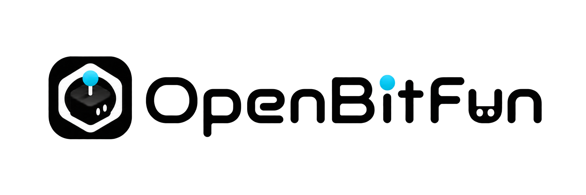
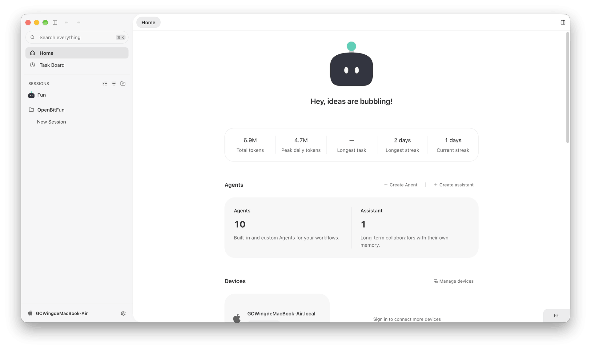
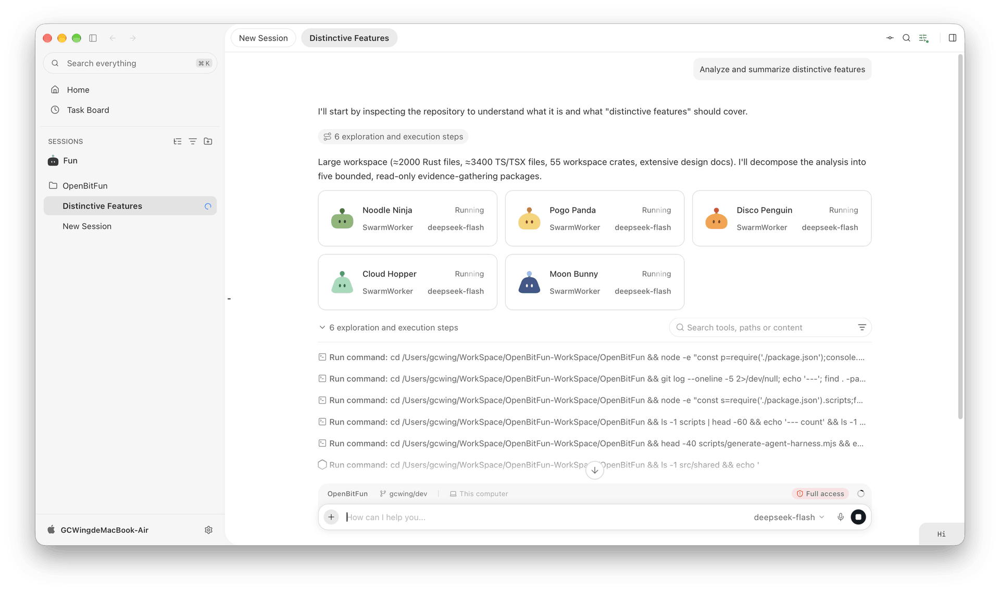
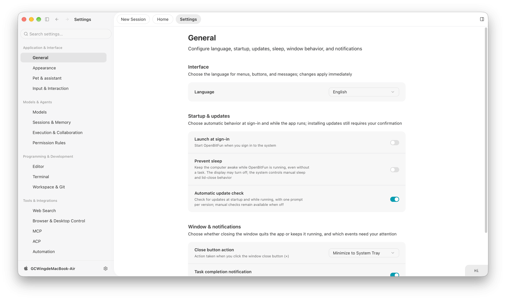
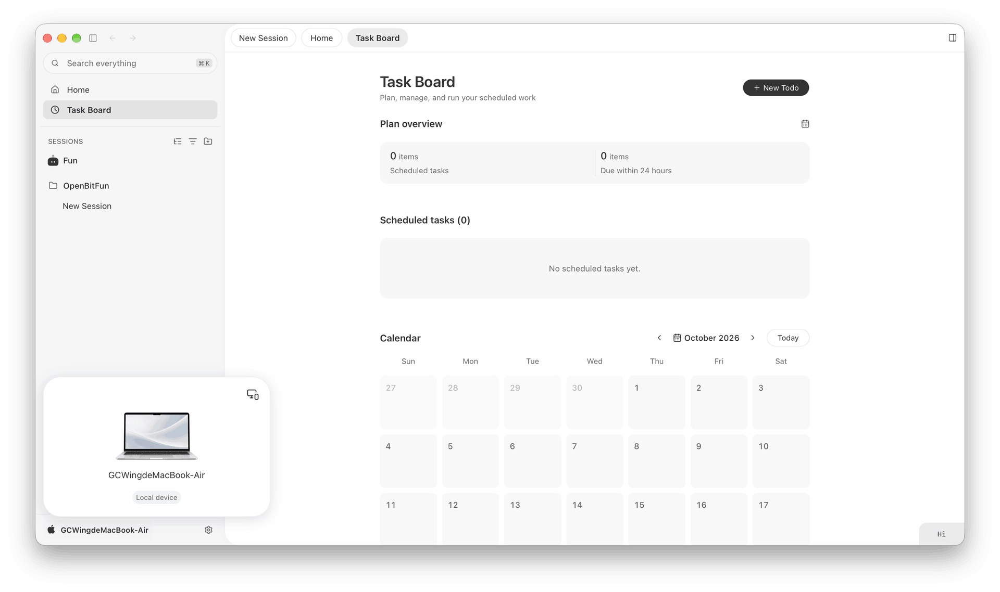
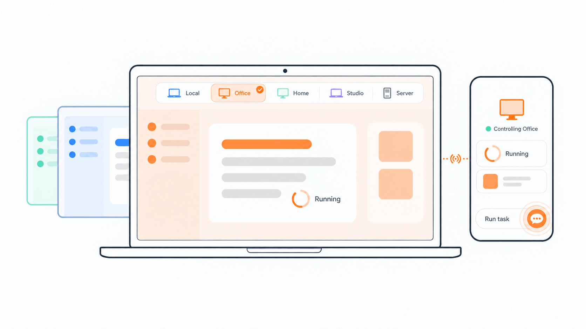
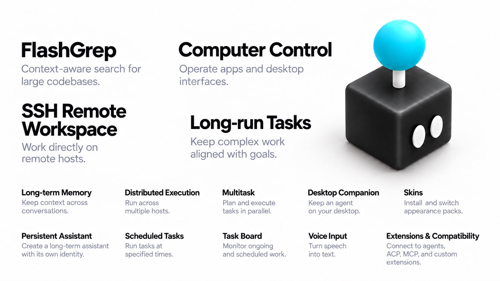

**中文** · [English](README.md)

<div align="center">



### 持续推进，直到完成。

OpenBitFun 是一个高度可定制的开源 Agent 工作台，让任务按你的方式持续推进。

**四种一流的 Agent Harness 模式** · **跨设备远程控制** · **从 Mini App 到源码，全面可定制**

**如果你也期待这样的 Agent，欢迎点亮 ⭐ Star，让更多人发现 OpenBitFun。**

[下载桌面端](https://openbitfun.com/zh/download) · [移动端 Release](https://github.com/GCWing/OpenBitFun/releases?q=mobile-&expanded=true) · [Mini App 市场](https://market.openbitfun.com/miniapp/) · [加入社群](#加入社区群) · [参与共建](./CONTRIBUTING_CN.md)

[](https://openbitfun.com/zh)
[](./LICENSE)
[](https://openbitfun.com/zh/download)

[](https://trendshift.io/repositories/44672)

</div>

---

<div align="center">
  <video src="https://github.com/user-attachments/assets/ff1780fa-d248-40f1-9582-82e0de3d2f46" controls width="800"></video>
</div>

---

<p align="center">
  
  
  <br />
  
  
</p>

## 四种模式，按你的方式工作

**Agent Harness 决定任务如何推进**，负责规划步骤、组织上下文、调用工具、协调多个 Agent 并整合结果。根据当前任务，选择适合你的协作方式：


| 模式 | 什么时候选 |
| --- | --- |
| **极简 · Minimal** | **即时协作。** 目标明确、希望快速动手时，AI 直接执行，你随时反馈，在协作中持续调整。 |
| **标准 · Standard** | **日常任务。** 工作需要多个步骤时，有序规划、逐步执行，并检查结果。 |
| **极致 · Ultimate** | **复杂任务。** 问题需要深入分析时，拆解任务，由多个 Agent 分工协作、整合结果。 |
| **创造 · Creative** | **创造与定制。** 想做自己的应用或扩展工作台时，创建 Mini App，定制 OpenBitFun 的界面与功能。 |

## 切换多台电脑，手机远程控制

**切换设备，整个工作台随之切换。** 在桌面端选择另一台已连接的电脑，界面就会切换到那台设备的会话、工作区、文件与任务状态。家中电脑、办公室电脑和服务器，都可以在同一个应用里切换查看与操作。

**手机就是远程控制端。** 通过手机或浏览器发送指令、查看进度、补充要求和处理授权。任务始终在所选设备上运行，切换界面或断开控制端连接后仍会继续。

**手机端支持单屏、双屏、三屏布局自由切换。** 单屏时专注对话，展开后并排查看会话与文件；界面随屏幕形态调整，让折叠屏的空间真正用起来。



<details>
<summary>连接与部署说明</summary>

工作区也可以通过 SSH 连接到远程主机、跳板机或容器，让文件、命令与 Agent 在目标环境中工作。桌面和 CLI 共享核心执行能力，移动端与消息机器人提供更多控制入口。

同账号设备互控、登录与同步服务由你[自部署 Relay](./src/apps/relay-server/README.md)。更多连接方式见[远程连接](./docs/interactive-capabilities/capabilities/feature.remote-connect.md)与[远程工作区](./docs/features/remote-workspaces.md)。

</details>

## 把想法，变成自己的应用

为仓库做一个 Git 洞察面板，为演示文稿做一个 PPT 工作台，或把常用操作集中到一张表单。**Mini App 让工作中的具体需求，变成可直接使用的小应用。**

描述需求，让 Agent 创建应用。每个 Mini App 都有自己的界面和 Agent 会话：你可以操作界面处理任务，也可以通过对话调整功能，让工具在使用中不断完善。

做好的应用可以安装、反复使用。你也可以去 [Mini App 市场](https://market.openbitfun.com/miniapp/)发现适合自己的工具。

## 用 OpenBitFun，创造 OpenBitFun

**从角色、工具到界面和源码，都可以按需定制。** 从贴合工作习惯的专属 Agent 开始，逐步扩展你的工作台：

- **定制专属 Agent。** 围绕漫剧创作、视觉设计、代码评审等领域，选择模型、设定角色，组合需要的工具与工作方法。
- **接入工具与流程。** 通过 MCP 连接专业工具，把常用工作方法保存为 Skills，用 Hooks 扩展任务执行流程。
- **改变界面与源码。** 安装[皮肤](https://market.openbitfun.com/skin/)调整外观，也可以修改 UI、工具与 Runtime 源码，构建自己的 OpenBitFun。

**你可以直接让 OpenBitFun 的 Code Agent 修改和扩展 OpenBitFun 本身。**

扩展方式见 [Agent 管理](./docs/interactive-capabilities/capabilities/feature.agents.md)、[Hooks 契约与兼容范围](./docs/features/agent-hooks.zh-CN.md)和[产品架构](./docs/architecture/product-architecture.md)。

## 持续执行，也认真对待效率

Rust Agent Runtime 承载会话状态、上下文管理与工具执行。持久会话、中断恢复、长期记忆与长程任务支持工作接续；上下文压缩和缓存复用帮助控制持续执行的资源开销。

在这组 **DeepSWE v1.1** 评测中，OpenBitFun 的表现：

- **GLM-5.3-Flash**：通过率 **64.6%**，耗时 P50 **42.9 分钟**。
- **DeepSeek-V4-Flash**：通过率 **56.6%**，耗时 P50 **19.6 分钟**。


## 功能墙

**图中只是 OpenBitFun 的部分功能。** 还有更多工具、工作流与扩展能力，等你在真实任务中探索。



## 我们想走向的未来

OpenBitFun 仍在演进，我们希望继续探索三个方向：

- **黑灯工厂**：白天讨论与设计，让任务在服务器上持续推进，第二天回到成果与验收。
- **无限半径**：从桌面与手机继续走向穿戴和嵌入式设备，让工作在更多地方接续。
- **应用进化**：从个人小工具到面向专业领域的定制版本，让更多人参与塑造软件。

更可靠的长任务、更高效的 Runtime、更从容的桌面体验，是这些探索共同的基础。

## 用它创造，也一起创造它

**欢迎用作品、反馈和代码参与 OpenBitFun 的未来。**

你可以分享真实任务与使用经验，贡献 Agent、Skills、Mini App 和皮肤，也可以从一处文档、一项交互或一个 Runtime 问题开始。想法与问题欢迎在本仓库的 Issues 和 Discussions 中讨论，开发流程见[贡献指南](./CONTRIBUTING_CN.md)。

<details>
<summary>下载、使用与源码运行</summary>

前往[官方下载页](https://openbitfun.com/zh/download)，选择 Windows、macOS 或 Linux 安装包。安装后配置模型，打开工作区即可开始；操作说明见[使用手册](https://playbook.openbitfun.com)，安装包签名见[下载校验](./docs/verify-downloads.zh-CN.md)。

**数据迁移提醒：** OpenBitFun 1.0.0 与 0.2.x 旧版数据不互通。需要迁移旧版数据时，请使用
[OpenBitFun 数据工具](src/apps/data-tools/README.zh-CN.md)，当前支持 0.2.17～0.2.19 正式版。

从源码运行需准备 [Node.js](https://nodejs.org/) 22.12+、[pnpm](https://pnpm.io/) 10.15.0、[Rust 工具链](https://rustup.rs/)和 [Tauri 前置依赖](https://v2.tauri.app/start/prerequisites/)。克隆本仓库后运行：

```bash
pnpm install
pnpm run desktop:dev
```

桌面开发环境支持前端热更新与 Rust 自动重编译。CLI 入口见 [CLI 使用说明](./src/apps/cli/README.md)。

</details>

核心代码采用 [MIT License](./LICENSE)，第三方依赖与资源遵循各自的许可证。感谢所有开源作者与贡献者。漏洞报告方式见[安全策略](./SECURITY_CN.md)。

## 加入社区群

使用微信扫描下方二维码，添加好友后申请加入 OpenBitFun 社区群。


## Star 历史

<a href="https://www.star-history.com/?repos=gcwing%2Fopenbitfun&amp;type=date&amp;legend=top-left">
  <picture>
    <source media="(prefers-color-scheme: dark)" srcset="https://api.star-history.com/chart?repos=gcwing/openbitfun&amp;type=date&amp;legend=top-left&amp;theme=dark" />
    
  </picture>
</a>
