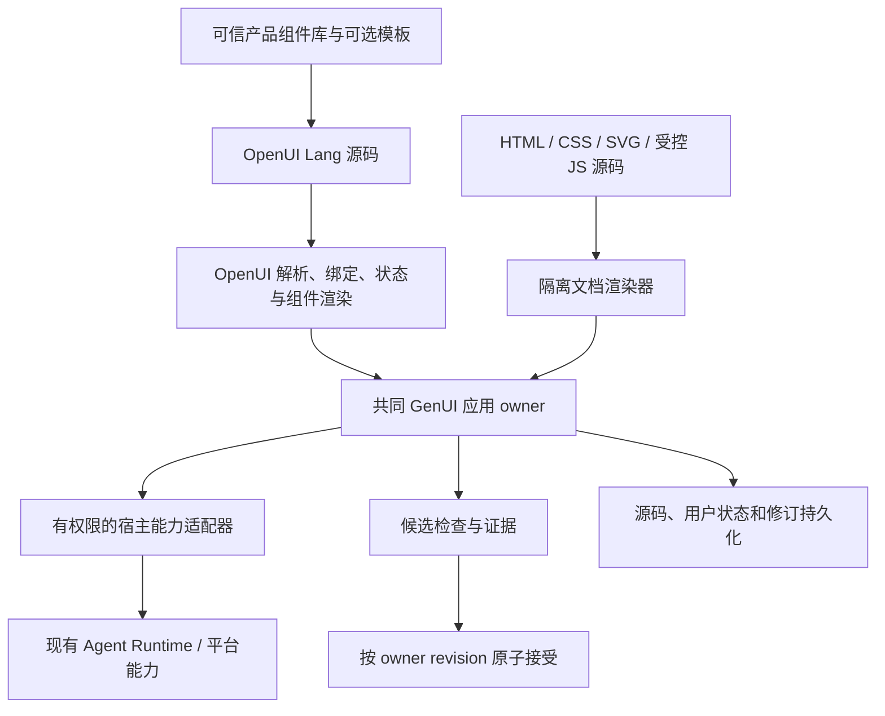

# GenUI 双路径应用架构

本文定义 GenUI 的目标产品和运行时边界。迁移未完成前，已接线代码仍是生产事实；本文中的目标能力不得据此描述为已交付。产品架构索引链接到本文件，本文件是 GenUI 架构的唯一专题设计文档。

## 产品决定

GenUI 提供两种源码表达，共用应用身份、版本、状态、宿主能力、持久化、候选验收和远程归属：

| 路径 | 模型生成的源码 | 适用范围 |
| --- | --- | --- |
| 组件应用 | OpenUI Lang 描述 | 表单、列表、看板、数据应用及可信组件可表达的交互 |
| 自由文档 | HTML、CSS、SVG，可选受控 JavaScript | 特殊排版、可视化、动画和组件库难以表达的交互 |

创建应用时，用户选择组件库及其绑定的 UI 规范配置。规范配置同时适用于两种源码类型，不是只供模型参考的风格 prompt。它定义可用组件库、样式资源、设计规则、支持的源码类型、目标视口、宿主绘制的外壳区域和必需验收项。自由文档必须在该视口中真实渲染、检查并根据可测诊断修正；不能从提示词或静态源码扫描推断其符合规范。

默认 `openui` profile 复现 Open Intelligent UI 的即时回答路径：模型流式输出 OpenUI Lang，Renderer 直接在 FlowChat 内联渲染，本地状态和声明动作立即生效，也不自动打开右侧工作台。只有显式选择 `harmony` profile 时，才进入 profile → design spec → viewport/shell → checker 的交付分层并提供侧栏展开；这套交付分层吸收 `harmony-genui` 的做法，把组件库选择绑定到可持久化、可执行验收的生成目标。OpenBitFun 将 Harmony 交付模式收敛到自己的应用 owner、权限和远程执行边界内。

组件路径直接采用 OpenUI `lang-core` 和 `react-lang` 的语言运行时。产品可以注册和扩展可信组件库；模板提供可选的起始结构和生成提示，不能限制模型自由组合现有组件。组件能力不足时，或用户明确要求自由设计时，使用自由文档路径。生成失败本身不是切换路径的理由；描述错误应携带诊断修复，只有组件表达能力不足才改用自由文档。旧的语义消息图已经退役；`source` 缺省的记录不可执行，必须由用户显式重新生成 OpenUI/HTML source。新组件生成只写入 `source.kind = openui-lang`。

模型不得生成 TSX、React 源码或其他需按应用编译的代码。不得恢复 Canvas TSX 编译链。可信组件的实现可以由产品开发者用 React/TSX 编写并随应用构建发布；这不属于模型生成执行路径。

MiniApp 保持自己的源码、打包、安装、权限及运行生命周期。GenUI 使用已有宿主和 Runtime 能力时通过其稳定接口，不把 MiniApp 改造成另一种 GenUI 源码格式。

## 系统边界

语言解析和渲染留在各自运行时；产品数据与交付生命周期只由一个应用 owner 管理。禁止把 OpenUI 源码翻译到旧节点图或流程解释器后再执行，也禁止把两种源码都转换成任意 HTML/JS 后失去各自的类型和信任边界。

| 所有者 | 职责 | 禁止事项 |
| --- | --- | --- |
| Agent 工具与 Assembly | 选择生成类型、固定组件库与 UI 规范 ID/修订、生成提示和候选身份 | 实现组件、文件 IO、浏览器沙箱或持久化 |
| OpenUI 产品库 | 组件契约、组合、提示、renderer、纯函数和受信任动作声明 | 访问会话 store、平台 API 或直接写用户数据 |
| 自由文档运行时 | 静态文档渲染、隔离脚本执行、桥接消息协议 | 暴露 Tauri、Node、宿主凭据或任意未经授权的接口 |
| GenUI 应用 owner | 源码/状态修订、候选、CAS、保存重开、证据和来源归属 | 解析或重新实现 OpenUI Lang 语义 |
| 平台与 Runtime adapter | 对文件、工具、Agent、网络和其他宿主能力做授权执行 | 使用控制端本地上下文代替目标 owner 的归属 |
| 候选 checker | 在隔离实例中检查源码、实际渲染和声明交互 | 触碰正式用户状态或产生真实外部副作用 |

## OpenUI 组件路径

### Library Registry 与组件库适配器

OpenUI 提供共同的 Lang/parser/state/Renderer 运行时，同时注册三套可独立选择的 profile：`openui` 使用上游 `openui.v1` native library，`openbitfun` 使用 `openbitfun.composable.v1`，`harmony` 使用 `openbitfun.harmony.v1`。每套 profile 都绑定自己的 adapter、prompt、CSS/style resources、design spec 和 revision；只读契约是同一 adapter 的明确权限变体，不能改变其来源身份。

`openbitfun` adapter 用 `@openbitfun/ui` 承载 Button、IconButton、Input、Textarea、Select、SegmentedControl、Checkbox、Radio 和 Card 等基础控件，再用 `oiComponents` 保留 Chart、Map、Svg、HtmlView、Table 和媒体等 GenUI 专用 renderer；所有实现都先绑定 OpenBitFun 的 contract 和 positional signature，再经过 adapter 自己的 DOM inspector、action/query bridge、CSS/token scope 和 revision 校验。`openui` profile 则直接使用 vendored `open-intelligent-ui/src/lib/library.ts`、其 `components/*` 和 CSS；它不经过 `oiComponents`。任何 profile 都不会携带第二套 parser、state 或旧 graph runtime。

应用保存 `libraryId` 与 `libraryRevision`，并在 owner readback、candidate evidence、远程请求和重开时逐字段校验。设置页只改变下一次生成使用的 registry entry；已接受应用由保存的 identity 解析 schema、prompt、designSpec、renderer 和 bridge，不能通过 template 或全局配置重新推断组件库。未知或缺少 identity 的记录保留原始内容并显示不可运行状态，禁止换成 OpenUI、OpenBitFun 或 graph fallback。

HOS7 暂不属于受支持的 GenUI 目标，不进入当前 library registry、生成 schema 或交付路径。后续如重新支持，必须以独立 adapter、明确许可、目标端能力协商和单独验收契约重新接入。Harmony-genui 只提取 design-system、token 和 Plot 能力，不嵌入旧 graph/schema/action runtime。

### 组件库与模板

以 OpenUI 的 `defineComponent`、`createLibrary` 和 `library.extend` 作为组件描述、schema、说明、renderer、函数、动作与组合规则的定义机制。产品注册可信实现；模型只能引用当前构建和产品配置实际提供的组件。添加、替换和移除组件必须同步影响生成提示及运行时校验，不能另外手写一份模型专用组件目录。

模型上下文必须同时包含 OpenUI Lang 的最小语法和当前 profile 的可执行提示。`openui` 使用上游生成的 system prompt 和上游 library spec；`openbitfun`、`harmony` 则从各自 catalog library 派生位置参数签名和 worked examples。Rust 工具 schema 只暴露当前 profile 的 template、library、revision 和 design spec，系统提示也只注入当前 profile 的 library。组件路径中的 `createRecord`、`patchRecord` 等旧兼容图动作不应被提示为 OpenUI `@` 动作。

同一产品可以提供多个有明确版本的组件库或扩展。组件库 ID 和修订在候选创建时固定，设置变化只作用于新候选。已有应用按它保存的库契约解析；未知库、运行时或组件版本应保留原始数据并显示不可用状态，不静默换库。

模板是可选的初始示例和任务约束。没有适合模板时仍可从所选库的合法根组件开始自由组合。组件库、模板、生成提示和检查器共享一份构建期产品定义；Rust 边界只验证通用 envelope、源码格式标识和 owner 约束，不复制 OpenUI parser 或运行语义。

组件作者提供实际 renderer、限于组件拥有 DOM 的 `inspect`，以及声明事件的隔离 `exercise`。探针只生成隔离状态，不得调用正式保存、权限接口或外部工具。任何外部副作用均通过 OpenBitFun 注册的宿主能力，遵守现有权限、取消、deadline、重试及远程 mailbox 语义。需要原子性的多步操作由一个 owner mutation 完成；OpenUI 顺序动作不自动等于事务。

### UI 规范配置与目标身份

产品配置以同一个版本化清单声明组件库 profile 与 `designSpec` 的绑定。规范至少包含 `componentLibraries`、`styleResources`、`rules`、`sourceKinds`、`viewport`、`shell` 和 `acceptance.checks`；构建校验确保 profile 的每个模板只使用规范允许的组件库。模型上下文收到选中规范的完整约束和资源 ID，模型不能自行选择或覆盖该身份。Rust owner 从受信任 profile/既有 owner 解析它，并在候选 app 中写入 `{ id, revision }`。

`designSpec` 是应用目标身份的一部分，与源码修订和状态分开持久化，但在候选 CAS、保存、重开和远程执行期间固定。修改既有 app（相同 app ID）继承 owner 已接受的规范，即使当前全局设置已改变；设置只决定新 app。显式更换规范必须是可检查的新 app 修订，检查组件库兼容性与用户数据迁移，不能在打开应用时跟随设置漂移。旧记录缺少该字段时显示不可运行，不再按模板推断或改写身份；未知/已移除规范保留原值并显示不可运行。

Owner 的读取和状态保存请求必须回显 `libraryId`、`libraryRevision`、`designSpec` 与 `sourceKind`；目标 owner 会把它们与已接受修订逐字段比较，缺失或不一致都返回 unsupported/error，不允许另一套 adapter 或源码类型的响应冒充当前应用。

规范的 `shell` 区分宿主绘制与生成内容。Harmony 手机规范固定 360 x 764 CSS px 视口，36 px 状态栏和设备外壳由宿主绘制，内容左右 inset 为 16 px，目标内容宽度 328 px。模型只能生成屏幕内容。OpenUI 组件路径使用规范绑定的 Harmony OpenUI library；HTML/CSS/SVG 路径收到同一身份、资源与规则，在相同宿主 shell 和固定视口验收。实际 DOM/几何检查至少验证视口尺寸、宿主 shell 部件、内容边界和横向溢出，并将精确诊断返回候选修正。若自由文档仍违规，修正后必须重跑同一规范检查；提示词本身不是通过证据。

### 流式和交互

从 Agent 工具参数事件中增量提取 OpenUI Lang 文本，使用 OpenUI 流式 parser 投影逐步完成的语句。传输 adapter 只负责解包、解转义、识别重置和追加，不解析语言、不重新实现语句缓存。组件预览使用固定的库修订；首屏允许本地状态交互，但会产生外部副作用的 action 仍须经过 owner、权限和交付层。候选结束后，完整原文必须经同一 OpenUI library 终态解析，且不得有未完成语法、未解析引用或阻断性 schema 错误。

React 组件身份和列表 key 必须经过真实插入、删除、重排测试。OpenUI statement ID 不等于所有数组渲染都具有稳定项身份；不能仅凭 parser 缓存断言焦点、输入状态或局部组件状态不会错位。确有上游缺口时优先以可追踪补丁修复或向上游提交，不复制 parser。

持久化的 OpenUI 用户状态使用版本化 JSON 数据，恢复后交给 `Renderer.initialState`，更新交给 `onStateUpdate` 与应用 owner。前端编辑态可以立即更新，只有 owner 确认写入后才能报告保存成功。外部查询和 mutation 必须进入宿主能力；状态更新不能绕过 owner CAS。

## HTML / SVG 自由生成路径

自由文档将 HTML、CSS 和 SVG 作为文档源码保存；交互脚本是独立、可选的源码字段。页面源码可以组织自己的 DOM、图形和动画，不能内嵌 TSX 构建器、远程脚本包或隐式模块加载器。模型不能通过脚本直接调用文件系统、Shell、内部 API、用户凭据或正式持久化。

隔离文档使用独立的 sandboxed iframe 和不透明 origin。允许执行脚本时使用 `sandbox="allow-scripts"`，不授予 `allow-same-origin`、表单提交、弹窗或顶层导航权限。宿主不通过 `contentDocument.write` 执行候选；以受控 `srcdoc`/文档更新通道交付源码，并在目标平台确认嵌入 API 不会把 Tauri 能力注入子文档。

内容策略默认拒绝网络、子框架、对象、表单目标、外部字体和外部脚本。候选检查和流式预览阶段不执行脚本；只在源码封存后的隔离检查实例启动脚本。HTML 预处理必须使用支持 SVG 的结构化 parser/sanitizer，删除脚本元素、内联事件属性、危险 URL 和不支持的嵌入资源；最终受控脚本从独立字段装载。拒绝 `eval`/`new Function`、动态 import 和远程模块。确有资源需要时，通过目标 owner 上明确定义并经授权的资源能力提供，不直接放开通用网络访问。

当前实现已经接通 `source.kind = openui-lang` 和静态自由文档 `source.kind = html-document`：前者交给 `@openuidev/react-lang` 的 OpenUI parser/renderer，并由产品 catalog 适配可信组件；后者把 HTML/CSS/SVG 以源码字段持久化，经过当前 HTML sanitizer 后放入不透明 origin 的全限制 sandbox iframe。脚本策略由宿主显式控制；检查模式使用一次性 nonce CSP，并在检查时禁用候选脚本。两者共用 designSpec、宿主外壳、布局检查、候选 CAS 和保存重开流程。自由文档 iframe 接收 designSpec/style-resource 元数据，并在宿主可提供 token 时复制受控的 OpenBitFun CSS token 基线，使 Harmony 的实际屏幕背景、文字和 SVG 默认使用同一套宿主资源；生成文档仍可显式覆盖自己的内容样式，规范检查继续以实际几何和宿主边界为准。OpenUI 的表单状态回调已经接入 owner 保存，组件声明的 action 通过 `Renderer.onAction` 传给 owner，`Query`/`Mutation` 通过 `GenUIAsyncRuntimeController` 适配成 OpenUI 的 `toolProvider`；它保留 OpenUI 的 cache/loading/error/retry 语义，并额外携带 AbortSignal、request identity、permission、target 和 targetId。已授权的 `ChatMcpCatalog` 通过 `createGenUIMcpProvider` 映射为同一 provider：只允许 catalog 中的 server/tool，JSON-RPC `result`/`error`、structured content 和 text content 在边界层解包，Mutation 必须由宿主显式列入声明。`Image`/`SearchImage` 的图片搜索、显式 URL 失败后的候选回退、`Map` 的异步 marker 查询和可选路线查询也使用同一 capability registry；宿主内置 provider 通过 `gen_ui_provider_call` 统一承接 360 图搜、百度图搜、Wikipedia/Commons、Nominatim、OSRM 和 Valhalla，组件不直接访问外部 `/api`。已授权的 MCP 同名 capability 优先，内置 provider 填充缺口；当宿主命令或目标端确实不可用时才保持显式 unsupported。source 替换、组件查询变化和卸载都会取消请求，迟到结果不能回写旧文档。自由文档的 `script` 默认仍不执行；只有宿主显式传入命名 `htmlBridge` 时才使用 `sandbox="allow-scripts"`，脚本通过 `window.openbitfunWidget.request` 发消息，父层校验 frame 来源、capability 名称并带 app/source/designSpec 身份调用 handler，再把结果返回。脚本入口会阻断 `eval`、`new Function` 和动态 `import`，CSP、opaque origin、无 same-origin/网络/表单/导航权限继续有效。产品仍需为每个宿主能力注册参数 schema、权限、取消和远程归属；iframe 不能被当作 CPU/内存级沙箱。生成脚本可以随自由文档源码保存，但在尚未协商出受控桥接能力的 host 上保持禁用。

自由文档的实际交付检查还会由宿主向 opaque iframe 注入一次性的只读 inspection probe。probe 不执行候选脚本，也不读取宿主凭据；它只报告可验证的视口、可见元素数量、内容边界和滚动尺寸，父层据此检查空白文档、固定屏幕宽度、横向溢出和目标内容边界。报告缺失、几何为零或内容越界都使候选失败，不能把 iframe `load` 或模型自报成功当作渲染通过。这个 probe 是 checker 的实现细节，产品宿主仍需在无法证明消息来源和 iframe 隔离时禁用自由文档脚本。

由于自由文档 iframe 使用不透明 origin，父页面的通用 DOM 截图工具可能只捕获宿主外壳而遗漏 iframe 像素。当前交付证据因此只把自由文档的真实加载、固定视口和宿主布局作为确定性检查，并将视觉截图标为 `unverified`；只有目标 host 提供可信的 iframe 截图适配器后，才可把图像交给视觉复核。

隔离页面仅通过按应用和实例绑定的宿主桥接请求允许的能力。宿主依据调用来源、应用 ID、源码修订和当前 owner 校验请求，消息按大小、频率、类型和参数 schema 限制；页面提供的 session、workspace、路径或设备标识一律不能决定执行目标。读文件、Agent 消息、外部工具和状态保存分别使用既有 owner 与权限流程。用户操作需要远程回答时必须走现有权限 mailbox。

iframe 和 CSP 是纵深防护，不是通用恶意代码 VM。浏览器可能无法在同一 WebView 内强制终止同步死循环或限定内存；不能宣称已获得进程级 CPU/内存隔离。启用模型生成 JavaScript 前，必须在 Desktop 的 WebView2、WKWebView、Linux WebKitGTK 及实际受支持 host 上验证 host API 不可见、网络/导航受限、消息可取消且 renderer 可恢复。某个 host 无法证明这些约束时，必须明确禁用该 host 的脚本执行并仍允许静态 HTML/CSS/SVG，不得静默用宿主权限执行。

## 共同应用与持久化契约

应用身份绑定目标设备/runtime、workspace、session 和应用 ID。每个接受版本保存源码及状态的独立修订；解析树、DOM 和截图是可丢弃的派生数据，不是权威存储。逻辑记录至少包含：

| 字段 | 语义 |
| --- | --- |
| `appId` | 跨修订稳定的应用身份 |
| `source.kind` | `openui-lang` 或 `html-document` |
| `source.formatVersion` | 源码语法或文档策略版本 |
| `libraryId` / `libraryRevision` | 两种源码路径都保存创建时绑定的 library contract；HTML 路径的样式和脚本能力仍由 designSpec 与 host runtime 共同约束 |
| `designSpec.id` / `designSpec.revision` | 两种源码类型共用、由 owner 固定的设计目标配置 |
| `htmlRuntime` | HTML 应用由 owner 写入的 runtime、sanitizer、inspector 和 bridge revision；组件路径不需要该字段 |
| `source.revision` / `source.content` | 源码修订与原始内容 |
| `state.revision` / `state.value` | 独立的用户数据修订 |
| `ownerRevision` | owner 并发控制版本 |
| `verification` | 精确绑定源码、状态、运行时、checker 和能力版本的证据 |

实际 wire/存储命名可以遵循现有领域契约，但须保留这些语义。Rust `Value` envelope 不解释源码；owner 不需要在 `app` 和 `widget_code` 间维护两份权威源码。每次编辑从已接受版本创建候选，源码和状态分别记修订，候选按 `baseOwnerRevision` 原子接受。过期、丢失确认的幂等重试、并发修改和未知字段由 owner 处理。

候选检查使用已接受状态的隔离副本，绝不覆写正式用户数据。检查可测试候选如何处理用户操作，但只有接受后用户界面才切换到它。保存失败时保留本地输入并显示失败状态；关闭重开从目标 owner 读取已接受源码和状态。格式或库切换是新修订；状态转换必须显式迁移并检查，失败时保留此前应用与数据。

## 统一实现约束与完成门槛

按可验证的纵向能力迁移，避免两条新路径各自建立一套应用 owner：

1. **固定源码边界并退役 TSX 执行链。** 新生成请求只接受 `openui-lang` 或 `html-document`。删除旧 Canvas 的模型 TSX 输入、逐应用编译和执行入口；旧记录保留为不可执行数据，可由用户显式导出或导入为待检查候选。
2. **建立共同 owner 与规范身份契约。** 引入版本化组件库/profile 和 `designSpec` 清单，将 `{id, revision}` 写入 app；引入带 `source.kind` 的源码修订、独立状态修订、owner revision 和候选接受语义。覆盖并发冲突、同 app ID 在设置改变后的规范继承和 source payload 往返，再让新路径以此作为唯一权威存储；旧 graph payload 不进入新 owner。
3. **完成 OpenUI 组件纵向切片。** 现在已用绑定规范的产品组件库打通 `source.kind = openui-lang` 的解析、渲染、流式输入、状态回调、action/query owner bridge 和 owner 保存/重开；async capability 层已补齐 Query/Mutation、图片、地图、取消、权限、远程 target 与 target event。宿主仍需为实际外部能力注册参数 schema、deadline、重试和远程 mailbox。没有合适模板时验证自由组合；库或语法诊断必须留在 OpenUI 语言语义内修复，不能转译到旧 JSON 图。
4. **完成自由文档静态纵向切片并收敛脚本门槛。** 已完成不执行脚本的 HTML/CSS/SVG 渲染、当前 sanitizer、style-resource token 基线和共同 owner 保存重开；每个规范在实际目标视口运行 DOM/几何验收，违规诊断交回修正并重验。当前证据带有 HTML runtime 的 revision；白名单式 sanitizer、参数化 bridge registry 以及各原生 WebView 的隔离证明仍是后续交付门槛。受控 JavaScript 仍按 host 单独开放；每个 host 先证明桥接权限、导航/网络限制、取消和恢复，再启用生成脚本。
5. **迁移候选验收与远程执行。** 组件和自由文档都由 owner 所在 runtime 按持久化的组件库及规范版本检查和接受。逐一验证 Remote Workspace、Remote Control、Peer Device 和 Detached Dispatch；能力缺失时明确 unsupported，不用本地渲染或 checker 代替目标端证据。

完成以行为证据为准，不以模块已创建或代码已编译为准。旧 graph 存储不进入新 owner，只有带 source 的候选才可接受；未验证的 host 或远程场景必须保持显式禁用或 unsupported。

## 候选验收与证据

组件和自由文档共用一条 owner 级交付门：

1. 固定 owner、应用 ID、源码类型和源版本；创建不覆盖已接受数据的候选。
2. 对原始完整源码做格式、语言/文档策略、组件库与 UI 规范版本校验，记录内容 hash。
3. 在目标执行端按规范的 viewport 和 host shell 启动隔离实例，检查实际挂载、运行异常、关键可见内容、布局、规范验收项和候选声明的交互。失败诊断绑定到该规范修订并用于修正；提示文本、schema 通过或截图单独均不构成规范通过。
4. 通过同一 owner 保存隔离检查状态，重读精确修订，再启动并断言恢复结果。
5. 将用户原始需求与实际 DOM/交互/保存证据一起做独立需求复核；有视觉模型时检查实际宿主截图。截图是临时检查输入，不保留为应用源码。
6. 只有全部必需阶段通过，且候选仍匹配基础 owner revision，才原子接受；否则保留旧版本并把具体诊断交还生成模型修复。

接受证据本身也必须带回候选的 `designSpec {id, revision}`；自由文档和
OpenUI 文档还必须带回相同的 `sourceKind`。owner 会逐字段比较这些身份，
所以远程 checker、过期的前端或另一套规范产生的证据不能被写入当前应用。

页面代码自报成功、Rust 结构校验通过或 React 已挂载都不能单独构成交付成功。模型审查不能代替运行器证据；无图像能力的检查器应把视觉项记录为 `unverified`，不伪称通过。检查设施不可用、超时或 owner 冲突与源码缺陷分开报告；可重试的检查阶段应重试同一候选，不要求模型无端改写源码。

组件作者提供的检查探针覆盖组件事件和 mounted inspect；应用级检查场景验证用户需求。自由文档检查器观察真实隔离实例并驱动受控测试事件，不能只采信页面向父级发送的“测试通过”消息。两种路径都保存精确源版本、状态版本、renderer/checker 版本和结果引用；HTML 路径还要记录 runtime、sanitizer、inspector 和 bridge revision。

## 远程与多入口

保存、检查、脚本宿主桥接和候选接受始终属于应用 owner 所在 runtime。控制端只呈现状态和发送命令，不代理文件系统、渲染权限或用户状态。运行和检查依赖的能力必须在目标端通告并协商；缺失时在准入或交付阶段明确返回 unsupported，不能静默在控制端本地执行。

| 场景 | 必须成立的行为 |
| --- | --- |
| Remote Workspace | workspace 路径与文件访问由远程 runtime 解释；不能把控制端路径转给目标端 |
| Remote Control | 断开后 owner 保留候选和可恢复阶段；远程权限请求可经现有 mailbox 回答 |
| Peer Device | 目标 peer 提供对应语言库、renderer、隔离脚本与 checker 能力；按 peer owner 修订 CAS |
| Detached Dispatch | 目标端可在无人值守条件下完成验证；缺 renderer/checker/脚本隔离能力时明确不接受候选 |
| CLI / Headless | 无交互 renderer 时允许明确报告 unsupported，不能伪造渲染/视觉证据 |

组件检查和自由文档检查使用同一远程生命周期，不要求每个客户端都安装或运行 renderer。Desktop 当前事件驱动的前端 checker 是一种 adapter，不是架构 owner；目标执行端需要能力，而不是持续连接的 controller window。

## 升级、历史数据与退役边界

存储新增字段必须可选并容忍旧记录。未知字段、未知 source format、损坏源码和未知组件库都原样保留；旧 graph 记录直接显示为不可运行，不进入 renderer、checker 或 acceptance，也不自动迁移。旧 HTML Widget 可以作为显式导入的 HTML 文档候选，导入后先应用新隔离策略和检查；TSX/Canvas 编译产物不得被自动执行或冒充 OpenUI。

当前实现中，OpenUI Lang 是组件路径唯一的生成语言和 parser；OpenBitFun 私有 graph 消息、表达式解释器、兼容 renderer 和组件专用 workflow 已从生成与交付链删除。自由文档是明确的 HTML/CSS/SVG 加可选受控 JS 类型，不是组件运行时的 fallback。旧 Canvas TSX compiler 与模型生成 TSX 执行链退役。产品边界不应保留 widget 和组件应用各自独立的身份、状态、验收或远程归属。

架构验证须覆盖两种表达不同的组件应用、无模板自由组合、真实工具参数流的渐进渲染、规范随 owner 保存重开与设置切换后的身份继承、Harmony 固定手机视口和 host shell、违反规则时实际诊断/修正/复验、自由文档 JS 隔离、状态修订、候选失败时旧版本保留、版本冲突，以及上述四类远程场景。Mock/DOM 测试不能证明原生 WebView 沙箱、远程执行或 Detached Dispatch；对应报告必须明确实际覆盖的 host 和场景。

当前本地交付证据（浏览器 fixture 使用真实 Chrome，owner/CAS 使用 Rust
持久化测试）包括：`pnpm --dir src/web-ui exec tsc --noEmit`、source-only GenUI
Vitest、`openbitfun-product-domains` GenUI 合同测试、
`openbitfun-services-integrations` GenUI owner 测试、Core GenUI/tool
测试，以及 `scripts/test-genui-browser.mjs`。浏览器 fixture 已实际检查
OpenUI action、`$name` 状态回传、Harmony `360x764` 外壳/状态栏/内容边界、
自由 HTML/SVG iframe、空白文档拒绝、受控 `htmlBridge`、设置切换、临时预览
状态和原生/deferred 流式 DOM 增长；Harmony owner 的保存/重开由 Rust 测试
单独覆盖。Remote Workspace、Remote Control、
Peer Device 的 live host 与 Detached Dispatch 的目标端 checker 尚未在这套
fixture 中冒充通过：Peer 缺少 `gen_ui_owner_v1`/`gen_ui_libraries_v1` 时会
结构化返回 unsupported，Detached Dispatch 的 GenUI 状态保存/重开也保持
明确 unsupported，直到目标端具备对应 owner 和 checker 证据。
