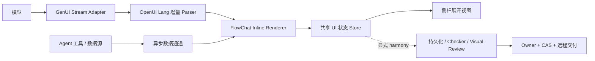

# GenUI 对齐 Open Intelligent UI 的交互改造规划

状态：核心切片已实施，持续收敛中

当前实现进度：FlowChat 内联、显式 Harmony 交付展开、原生 `GenUIStream`、OpenUI 增量渲染、首屏生命周期状态、严格的 `messageId + seq` 重排、P0 布局/标题原语和默认内容组件已落地。默认 `openui` 路径采用 Open Intelligent UI 的即时交互语义，不进入右侧工作台；`harmony` 才进入交付 checker/owner/CAS。固定 benchmark 仍不作为门槛。

本文把 BitFun GenUI 的首屏体验、流式协议和交付边界对齐到 Open Intelligent UI，并记录当前实现边界。现有的 owner、CAS、远程归属、候选验收和安全边界继续有效；本规划调整的是这些能力进入用户体验的时机和承载方式。

## 已确认的产品决定

以下决定作为本次改造的约束：

1. GenUI 直接内联渲染在 FlowChat 中，不再先显示一个工具卡片再打开应用。
2. 默认 OpenUI 不打开右侧工作台；只有显式 Harmony 交付才提供“展开查看”目标，且不能成为首屏 UI 的唯一入口。
3. 模型直接流式输出 OpenUI Lang，传输层不把整段源码包在一个必须完整闭合的 JSON 字符串中。
4. 默认 `openui` 首次渲染不进入交付验收：先显示可用 UI，后校验不属于默认生成路径。
5. 默认库采用 Open Intelligent UI-compatible 的 OpenUI 组件集合，至少包含 `Markdown`、`Image`、`Chart`、`Map`、`SVG`、`List`、`Table`、`Slider`、`DatePicker`、`HtmlView`。
6. owner、CAS、远程归属和安全检查只在显式 `harmony` 交付模式保留，不阻塞默认 OpenUI 首屏生成。
7. 8～16 个固定 benchmark 暂不纳入本期交付，先用纵向场景和手工验收验证核心链路。

## 目标体验

用户在 FlowChat 中提出一个需要结构化结果的问题后，体验应当是：

```text
用户问题
  → 模型开始输出 OpenUI Lang
  → FlowChat 出现首个可见组件
  → UI 随模型输出持续增长
  → 图片、地图和查询结果异步填充
  → 用户在当前消息内直接操作控件
  → （仅 Harmony 交付）需要更大空间时再展开到侧栏
  → 默认停留在当前答案；只有显式 Harmony 交付才后台保存、验收和生成交付证据
```

首屏的产品语义是“正在形成的答案”，不是“正在生成的应用”。用户不打开侧栏也应能完成主要任务；侧栏只是同一份 UI 状态的更大视图。

## 目标架构



首屏渲染、数据填充和交付验收是三条相互协作但不互相阻塞的路径：

- **内容路径**：模型输出 OpenUI Lang，解析为可渲染的增量 AST。
- **数据路径**：工具结果通过明确的数据事件填充图片、地图、图表等组件。
- **交付路径**：后台对最终源码和状态执行 checker、visual review、persistence 和 owner CAS。

默认 `openui` 路径只走内容和数据路径；显式 `harmony` 才开启交付路径。三条路径共享 `appId`、`sessionId`、`turnId` 和 source revision，但默认 OpenUI 不等待交付完成。

## 流式传输协议

传输层只负责事件边界、顺序、取消和错误，不解释 OpenUI Lang 语义。当前 runtime 的 `ToolEventData::GenUIStream` 使用如下 envelope：

```ts
type GenUIStream = {
  event_type: 'GenUIStream';
  tool_id: string;
  tool_name: 'GenerativeUI';
  message_id: string;
  seq: number;
  format: 'openui-lang';
  text: string;
  reset: boolean;
  app_id?: string;
  title?: string;
  template?: string;
  library_id?: string;
  library_revision?: number;
};
```

实现要求：

- `text` 直接承载 OpenUI Lang 片段，不再嵌入一个必须完整闭合的 JSON 字符串。
- 前端维护可恢复的增量缓冲区，每次收到 delta 都尝试解析当前可完成的语句。
- parser 产生 AST 增量或局部更新，renderer 只更新受影响的子树。
- 不完整的语句可以暂时不显示，但不能阻塞已经完整的语句。
- 异步数据请求在 UI 已经出现后独立更新；数据失败只影响对应组件。
- `Completed`、`Failed` 或 `Cancelled` 表示模型流结束，不表示 persistence、checker 或 visual review 已完成。
- 取消、断线和重试必须绑定 `messageId` 与 `seq`，避免旧流覆盖新流。

显式 `harmony` 交付时，最终源码仍需使用同一 OpenUI library 做终态解析和校验；默认 `openui` 不运行 checker、visual review 或 owner acceptance。

当前落地由 provider stream 直接发出 `GenUIStream` 事件：事件携带已经从工具调用 framing 中解出的 OpenUI Lang 文本增量、`message_id`、`seq`、`format` 和 `reset`。GenUI 不再从 `ParamsPartial` 反推源码，也不维护旧的双协议兼容层；OpenUI 语义仍由 OpenUI parser 负责。`Completed`、`Failed` 和 `Cancelled` 事件承担终态，不把 persistence、checker 或 visual review 塞回首屏事件。

## FlowChat 承载方式

### 内联消息

新增 `GenerativeWidgetInline` 作为 FlowChat 消息内容的一部分，接收：

- 当前的 OpenUI Lang 增量 AST；
- 共享的变量和 action 状态；
- 异步数据 request 状态；
- 当前消息的 `messageId`、`turnId` 和 source identity。

`GenerativeWidgetToolCard` 已从当前工具卡注册和实现中清理。GenUI 由 `FlowToolCard` 直接路由到 `GenerativeWidgetInline`，不再通过工具卡片 DOM 承载真实生成内容。

### 侧栏展开

Harmony 侧栏 renderer 和内联 renderer 复用同一个 projection、owner 和应用状态；默认 OpenUI 没有侧栏展开入口：

- 展开不会重新生成源码；
- 展开不会复制一份独立状态；
- 内联和侧栏的控件操作看到同一份变量状态；
- 侧栏关闭后，内联视图继续保留当前状态；
- 只有明确进入 Harmony 交付并需要更大空间或长期使用时才打开侧栏。

### 流式状态

FlowChat 至少需要表达以下状态：

| 状态 | 用户看到的内容 |
| --- | --- |
| `starting` | 轻量 skeleton 或生成提示 |
| `streaming` | 已完成语句立即渲染，未完成部分继续等待 |
| `data-pending` | 组件可见，图片/地图/查询区域显示局部 loading |
| `interactive` | 已有控件可以直接操作 |
| `complete` | 模型流结束，后台验收仍可继续 |
| `delivery-pending` | UI 可用，保存/验收在后台进行 |
| `degraded` | 保留可用 UI，并显示局部错误或不可持久化提示 |
| `failed` | 无法生成任何可用 UI 时回退到普通文本错误 |

## 默认组件库补齐顺序

### P0：首屏和局部交互

- 布局：`Col`、`Row`、`Box`、`Card`、`Grid`
- 文本：`Title`、`Text`、`Markdown`、`List`
- 控件：`Button`、`Input`、`Select`、`Slider`、`Checkbox`
- 数据展示：`Table`、基础 `Chart`

### P1：Open Intelligent UI 的核心场景

- `Image`
- `Map`、`MapMarker`
- `DatePicker`
- `RadioGroup`、`SegmentedControl`
- `Carousel`、`Popover`

### P2：高级表达和受控自由内容

- `SVG`
- `HtmlView`
- `Code`、`Quote`、`Timer`
- 需要隔离和能力白名单的自定义 HTML 交互

每个组件必须同时提供：

- OpenUI Lang 的位置参数签名；
- 生成提示和最小示例；
- React renderer；
- 状态绑定方式；
- 可测试的 action 或 query bridge；
- 主题 token 和响应式规则；
- 不依赖 FlowChat store 的纯组件实现。

## 状态、动作和工具数据

GenUI 交互状态分为三层：

1. **本地交互状态**：slider 值、筛选条件、选中项、展开状态。
2. **答案计算状态**：图表数据、排序结果、汇总数字和派生列表。
3. **助手会话状态**：只有需要模型理解、外部工具或追问时才更新。

原则如下：

- `@Set`、`@Reset`、`@CopyToClipboard` 等本地动作不重新调用模型。
- `@ToAssistant` 只用于需要继续推理或调用工具的操作。
- 图片、地图、搜索和外部查询先渲染占位，再通过 `data` 事件局部更新。
- 工具失败显示局部 error，不清空已经生成的其他组件。
- 任何外部副作用仍然经过现有 capability、权限、取消、deadline 和远程 mailbox。

## 交付和恢复层

owner、CAS、远程归属、安全检查和 visual review 保留，但执行时机调整为：

```text
首屏可用 UI
  → 后台保存候选源码和局部状态
  → checker 在隔离实例中运行
  → visual review 生成证据
  → owner 按 CAS 接受
  → 生成可重开、可远程恢复的交付版本
```

约束：

- 首屏 renderer 不得直接写正式 owner 状态。
- 后台 persistence 失败时，保留本地临时状态并明确标记 `delivery-pending` 或 `degraded`。
- checker 失败不能撤销已经展示的临时 UI，只能阻止交付或保存为正式版本。
- 远程端能力不足时返回明确 `unsupported`，不得偷偷在控制端本地执行。
- 恢复时仍按 `appId`、`source.revision`、`state.revision`、`ownerRevision`、`libraryId/revision` 和 `designSpec` 校验身份。

## 实施阶段

### M0：基线和开关

- 固定 OpenUI inline 模式作为当前 FlowChat 路径。
- 清理已经失去调用方的 deferred/panel 工具卡实现；owner、CAS、远程归属和安全检查继续保留在交付层。
- 将当前大规模迁移清理与本次交互改造分开提交。
- 固定 `messageId`、source identity、session/turn 关联方式。
- 确定首批纵向场景：文本+Markdown、表单、表格+图表、图片、地图。

### M1：FlowChat 内联首屏

- 实现 `GenerativeWidgetInline`。
- 让 `GenerativeWidgetPanel` 只负责共享应用渲染、状态与展开入口。
- 加入 skeleton、局部 loading、局部 error 和取消恢复。
- 建立内联与侧栏共享 `GenUIStateStore`。

当前代码已经提供 `starting`、`streaming`、`data-pending`、`interactive`、`complete`、`delivery-pending`、`degraded` 和 `failed` 的用户可见状态；没有首屏源码时使用轻量 skeleton，交付失败保留已渲染内容。

交付条件：不打开侧栏也能看到并操作第一批 UI。

### M2：OpenUI Lang 增量链路

- 实现 runtime `ToolEventData::GenUIStream` envelope。
- 移除完整闭合 JSON 字符串作为首屏前置条件。
- 接入增量 parser 和 AST 局部更新。
- 处理乱序、重复、取消、断线和重试。
- 将 `Completed`/`Failed`/`Cancelled` 与 delivery lifecycle 分离。

当前前端还会缓存未来序号、忽略重复序号、要求新 `messageId` 显式 `reset`，并在终态后拒绝迟到事件；provider snapshot 回退仍由 runtime 负责解包和 reset，OpenUI 语义仍只由 parser 负责。

交付条件：完整语句可以在流结束前显示，局部解析失败不会清空已显示内容。

### M3：核心组件和局部交互

- 先完成 P0 组件，再完成 P1 组件。
- 为每个组件补齐 library spec、prompt、renderer、state/action contract。
- 将本地控件状态与模型会话解耦。
- 接入图片、地图、查询和图表的异步数据填充。

默认库目前包含 `Col`、`Row`、`Box`、`Grid`、`Title`、`Text` 以及 Markdown、Image、Chart、Map、SVG、List、Table、Slider、DatePicker、HtmlView。图片搜索和地图查询现在也经过统一的 async capability provider；它们先显示占位/局部 loading，再独立填充数据，不在组件内部直接访问 `/api`。

### Query/Mutation 与异步数据通道（已落地）

OpenUI `Renderer` 仍负责 Query/Mutation 的 cache、loading、error、retry 和 invalidate。BitFun 在 `GenUIAsyncRuntimeController` 外包一层宿主边界，给每次调用补上 `appId`、`sourceKey`、`requestId`、operation、AbortSignal、permission、target 和 targetId。provider 只实现 `call(name, args, context)`，组件不接触权限和远程归属。

- `query`、`mutation`、`image-search`、`map-query` 共用同一 capability registry；未注册、未授权、目标不匹配或 peer 缺少 target id 时直接返回结构化拒绝。
- 语义 source 替换和卸载会 abort 当前 generation；同一 OpenUI source 的 token 增量不会改变 runtime identity。组件自己的 query 变化还会 abort 本地请求，旧结果即使底层 promise 忽略 signal 也不会回写当前 UI。
- 流式策略与 Open Intelligent UI 对齐：parser 保留已经完成的 statement，组件按 `statementId` 原地 reconcile；图片查询使用 500ms debounce，路线查询使用 700ms debounce，均允许在 stream 中启动并在 query/key 变化时取消。MapLibre 只创建一次，stream 中只更新已完成 marker，camera fit 和路线动画等重操作等 stream 结束；`HtmlView` 在 stream 中只显示准备态，结束后才创建 sandbox iframe，避免每个 token 重载页面。
- `Image`/`SearchImage` 使用 `image.search`（也接受显式 `SearchImage` capability）填充 URL；默认由宿主 provider 先走 360 图搜，再尝试百度图搜，国内源没有结果时再复用 Wikipedia/Commons，MCP catalog 中已授权的同名能力优先。没有结果时显示 OI 风格的图像空态，显式 URL 加载失败后按 Open Intelligent UI 的顺序切换到 provider 候选。`Map` 使用 `map.lookup`（也接受 `Map` capability）填充 marker；默认宿主 provider 使用 Nominatim，路线先走 OSRM、再回退到 Valhalla，已授权的 MCP `map.lookup`/`map.route` 优先，没有路线结果时保留 marker 直连的 overview，静态 markers 仍可立即渲染。
- 地图 marker 选择通过 `GenUITargetEvent` 回传 owner，并带目标端身份；provider 可同时把事件投递到远端 mailbox。事件不会把 Query 结果混进普通 conversational action。
- Chat MCP catalog 通过 `createGenUIMcpProvider` 接入 Query/Mutation：catalog 是唯一准入清单，默认工具按 Query 处理，写操作需宿主显式声明；MCP JSON-RPC 结果、结构化内容、错误和 AbortSignal 均在 provider 边界处理。

这与 Open Intelligent UI 的差异主要在宿主层，而不是重新实现 OpenUI 语义：OpenUI 本身仍管理 Query/Mutation 生命周期，BitFun 只增加 capability admission、取消、远程 target 和 owner event delivery。Open Intelligent UI 的 `SearchImage` 默认直接访问 `/api/wiki` 与 `/api/image-search`；BitFun 保持宿主安全边界，通过已授权 catalog 映射的显式 `image.search` provider，并兼容直接数组、`photos`/`images`、结果列表以及 wiki/image-search 分桶返回。地图已经使用 MapLibre、OpenStreetMap 派生 vector style、raster fallback、地图控件和可展开探索；路线由显式 `map.route` provider 提供 OSRM/GeoJSON 等街道几何，provider 暂不可用时保留可用的 marker 直连 overview。Open Intelligent UI 还提供 `CopyToClipboard` 等本地 custom action，BitFun 已注册同名 action，优先使用 Clipboard API，失败时走 WebView 可用的 `execCommand` fallback，同时把结构化 action event 交给 owner。OpenUI runtime 当前不会把 AbortSignal 传给 `ToolProvider`，所以 BitFun 的 controller 负责补齐这一层，并在 source 生命周期结束时强制终止旧请求。

交付条件：核心场景可以在当前 FlowChat 消息内完成主要操作。

### M4：显式 Harmony 交付、恢复和安全边界

- 只有显式选择 Harmony GenUI 时才运行 persistence、checker、visual review。
- 将候选和正式 owner 状态分开。
- 验证 CAS 冲突、保存失败、断线恢复、远程 unsupported。
- 确保 HtmlView、SVG 和其他自由内容仍受隔离、能力白名单和 host 限制。

交付条件：首屏不被交付失败阻塞，正式版本仍满足现有安全和归属约束。

### M5：灰度和后续评估

- 默认使用 inline 模式；当前代码不保留已经没有调用方的旧工具卡 fallback。
- 记录首个有效组件、首个可交互组件、完成时间、局部失败和交付结果。
- 8～16 个固定 benchmark 暂缓，待 M1～M4 稳定后再决定是否纳入质量门槛。

## 代码落点

首批改造重点文件：

- `src/web-ui/src/flow_chat/components/GenerativeWidgetInline.tsx`
- `src/web-ui/src/flow_chat/components/GenerativeWidgetInline.appearance.ts`
- `src/web-ui/src/flow_chat/components/GenerativeWidgetInline.test.tsx`
- `src/web-ui/src/flow_chat/utils/generativeWidgetProjection.ts`
- `src/web-ui/src/tools/generative-ui/GenUIApplication.tsx`
- `src/shared/generative-ui/catalog.json`
- `src/crates/assembly/core/src/agentic/tools/implementations/generative_ui_tool.rs`

建议新增的边界模块：

- `src/crates/contracts/events/src/agentic.rs` (`ToolEventData::GenUIStream`)
- `src/crates/execution/agent-stream/src/tool_call_accumulator.rs`
- `src/web-ui/src/tools/generative-widget/GenerativeWidgetPanel.tsx`
- `src/web-ui/src/tools/generative-ui/useGenUIOwner.tsx`

## 本期完成标准

本期不以“生成了一个可持久化应用”作为首屏成功标准，而以以下行为作为完成标准：

- GenUI 直接出现在 FlowChat 内联消息中。
- 侧栏是可选展开，不是必经入口。
- OpenUI Lang 片段可以增量传输和渐进渲染。
- 首个可用组件不等待完整源码、persistence、checker 或 visual review。
- 控件可以在消息内部完成本地状态交互。
- 图片、地图、图表和查询结果可以异步局部更新。
- persistence、checker、visual review 失败时不清空已经展示的 UI。
- owner、CAS、远程归属和安全检查仍然覆盖正式交付和恢复。
- 旧工具卡和 iframe renderer 已清理；需要恢复时仍通过 owner/CAS、源版本和安全检查恢复正式交付版本。

固定 benchmark、完整跨设备矩阵和更多高级组件属于后续质量建设，不作为本期阻塞条件。
