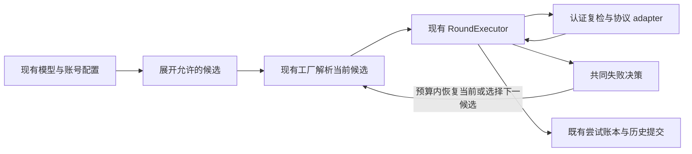

# 多服务商、多渠道与多账号路由：最小集成方案

当前实现：模型设置提供按服务商分组的独立账号管理与额度展示；模型连接可固定账号或声明顺序账号池，也可显式声明备用渠道。Peer 与 Detached Dispatch 按能力协商这些配置，缺失能力时保留记录并明确拒绝操作。冷却状态展示与手动解除、完整物理远程验收和跨版本应用并存仍不在已验证范围。

## 1. 目标与边界

供 OpenBitFun 自身 Agent 使用：用户明确配置允许使用的模型连接和账号；当前候选无法完成请求时，在保留完整历史、遵守授权范围且不重复执行工具的前提下，使用备用候选。不能安全切换时保留历史、说明原因并给出可执行的恢复操作。

最小交付同时包含以下三种能力，不能以 Codex 多账号替代整个目标：

| 能力 | 最小交付 |
|---|---|
| 多服务商 | 已接入的 OpenAI Chat/Responses、Anthropic、Gemini 及订阅渠道可被用户明确选为主备；不同模型名称也可显式选入，不推测模型等价 |
| 多渠道、多 key | 引用现有模型配置 ID，每个连接使用自己的端点、协议、模型及凭据；同一服务商的多把 API key 可配置为多个独立连接 |
| 多账号 | Codex、Antigravity、OpenCode Zen、Grok、Hermes、WorkBuddy 和 ZCode 均使用独立账号槽位、固定账号和顺序账号池；登录、可信路由与额度查询分别按 adapter 能力处理 |

首版仅支持明确的顺序主备和手动固定选择。复用现有 Rust 模型链路、认证存储、客户端工厂与 Agent 回合，不引入网关、sidecar、daemon 或另一套工具执行循环。

额度快照帮助减少明显无效的请求，实际请求结果决定本次是否失败。准确预测所有套餐、积分和工作区计费规则不是主备切换的前提。

当前服务商边界如下；这些实现事实不替代真实服务商验收：

| 订阅渠道 | 授权与身份 | 多账号请求路由 | 额度查询 |
|---|---|---|---|
| Codex | 浏览器 / 设备码；ChatGPT 席位身份 | 每槽位凭据与刷新租约，沿用账号绑定的 Responses 路由 | 现有服务商快照 |
| Antigravity | 执行主机浏览器回调；Google 用户 ID / ID token subject | 每槽位 Code Assist 凭据，沿用可信项目发现与请求链路 | 暂不支持，显示未知，由请求验证 |
| OpenCode Zen | 设备码；Console 用户身份与各账号目录 | 按所选账号解析协议、模型、组织请求头及可信 Console 端点；不向公开 Zen/Go key 路由发送 OAuth token | 暂不支持，显示未知，由请求验证 |
| Grok | 设备码；服务商 JWT subject | 每槽位刷新，使用 Grok Build 的可信 Responses 与模型目录端点 | 暂不支持，显示未知，由请求验证 |
| Hermes | 设备码；推理 scope 与 JWT subject | 每槽位轮换刷新，沿用可信 Nous 推理端点及 Chat 协议 | 暂不支持，显示未知，由请求验证 |
| WorkBuddy | 国内 / 国际区浏览器授权及服务端轮询，保留企业身份 | 每槽位刷新与账号目录发现；地区身份独立 | 按个人 / 企业身份读取额度 |
| ZCode | Z.ai / BigModel 浏览器授权及服务端轮询 | 仅接入有效个人或团队 Coding Plan 的项目 key | 按地区、组织及项目读取限额与附加额度 |

没有上游身份证明时不推测身份；已知身份不能被重登或迟到刷新换绑。其他渠道的签名/不透明历史仍使用包含凭据的回放指纹，令牌轮换不自动获得跨凭据回放资格。OpenCode Go 保持 API key 路径。

### 历史会话的支持边界

这是功能承诺的一部分，必须在产品入口和验收中体现：

| 历史或请求状态 | 首版行为 |
|---|---|
| 新请求或完整可迁移历史，当前尝试尚无有效输出 | 允许在已声明候选中切换；既有工具调用与结果完整传递，不重新执行 |
| 含签名、账号绑定的不透明 reasoning 或受限 continuation | 路由模式（渠道路由或账号池）优先发回最近的来源账号/渠道以保留推理连续性和缓存；来源不可用或切换候选时，本次请求降级为可迁移历史（去掉签名、签名推理文本和不透明回放，保留文本、工具调用和结果），会话记录保留原文。固定账号/未路由模型仍固定来源，不可用时停止并说明限制 |
| 池模式下，不透明历史缺失或混杂来源证明 | 只保留最近来源的签名状态，其余及无来源证明的部分降级为可迁移历史；不猜测默认账号 |
| Anthropic thinking 下的工具循环缺少签名 thinking 块 | adapter 对该次请求关闭 thinking（不支持 disabled 的模型省略该字段），下一个用户回合重新开始签名循环 |
| 当前尝试已有文本、reasoning 或工具调用片段 | 不跨候选拼接输出；瞬时流故障仅沿用既有恢复规则 |

手动换渠道、改端点或更换 key 不能绕过回放来源约束。同席位令牌轮换与换账号是不同操作；只有 adapter 能证明身份连续时才允许前者保持回放资格。首版不承诺所有历史都能跨账号或跨服务商继续，也不通过删历史、删 reasoning 或默认关闭 reasoning 制造成功。

无法迁移时，可恢复原账号授权、等待来源额度恢复，或由用户明确开始新会话；新会话不应被呈现为原历史的无损接续。放宽回放限制需要对应 adapter 的兼容性证据，单独评审。

## 2. 当前实现与收敛差距

以下是当前工作区的代码事实，不是发布完成声明；历史测试结果不得自动作为后续修改的证据。

| 领域 | 已有实现 | 收敛方向或缺口 |
|---|---|---|
| 账号与认证 | [账号槽位](../../src/crates/adapters/ai-adapters/src/subscription_auth/accounts.rs)、各服务商认证模块、[发送前身份复检](../../src/crates/adapters/ai-adapters/src/subscription_auth/request_identity.rs) | 已登记订阅服务商按槽位处理身份、刷新、退出和启停；额度查询及回放资格仍分别判定，不推定未来服务商也支持 |
| 配置 | [AuthConfig](../../src/crates/contracts/config-contracts/src/types.rs)、[渠道配置](../../src/crates/contracts/config-contracts/src/channel_routing.rs)、[旧账号配置保护](../../src/crates/contracts/config-contracts/src/protected_account_models.rs) | 保留现有形状，先统一运行流程，不借本次收敛做数据迁移 |
| 路由 | [账号 source](../../src/crates/assembly/core/src/infrastructure/ai/account_client_source.rs)与[渠道 source](../../src/crates/assembly/core/src/infrastructure/ai/channel_client_source.rs)继续分别拥有账号/渠道事实与已有偏好，共同失败决策已接线 | 工厂与回合回归覆盖同渠道账号和跨渠道顺序；完整原生 runner 仍需重新对齐当前界面，不另建通用调度框架 |
| 请求执行 | [客户端工厂](../../src/crates/assembly/core/src/infrastructure/ai/client_factory.rs)、[RoundExecutor](../../src/crates/assembly/core/src/agentic/execution/round_executor.rs)已接入账号与渠道路径，初始准备结果向回合传递，HTTP/流失败共用候选恢复入口 | 保持唯一回合预算；历史要求原来源时重新解析，实时授权检查仍在发送前进行 |
| 额度 | [adapter](../../src/crates/adapters/ai-adapters/src/subscription_auth/quota.rs)提供快照并解释模型级资格，[Runtime](../../src/crates/execution/agent-runtime/src/account_routing.rs)校验资格的身份、模型及有效期 | 计费组合解释及对应回归已移至 adapter；保留旧快照，不扩大拒绝范围。服务商真实额度语义仍未验收 |
| 状态与统计 | [路由偏好](../../src/crates/services/services-core/src/routing_state.rs)、[逐尝试账本](../../src/crates/services/services-core/src/token_usage/service.rs)及页面已有接线 | 后端尝试归属、未知用量与不重计能力保留；统计继续消费逐尝试账本。渠道绑定与账号回放来源分别记录，不把同渠道换账号拆成不同渠道 |
| 产品入口 | 模型设置按服务商管理账号，并展示账号或已保存模型的额度；连接编辑保留固定账号、账号池及主备渠道配置 | DOM、API 与设备作用域契约分别验证；完整原生 runner 需与当前界面重新对齐，不将历史结果视为本版验收 |
| 跨进程容量 | 独立服务原语保留，产品路径已撤出 | 不作为本方案依赖；普通请求不读写容量文件，旧文件原样保留 |

账号与渠道的分层配置有用途，但不要求执行器长期协调两套相似的调度流程。收敛发生在现有 owner 内，不新增通用调度框架或迁移 Runtime 所有权。

## 3. 最小实现方案

### 3.1 配置保留，执行候选统一展开

只使用四个必要概念：

- **服务商**：协议和认证语义的 owner，沿用现有标识。
- **账号**：稳定的授权槽位，与上游账号/组织/席位绑定；邮箱和名称仅用于展示。
- **渠道**：现有 `AIModelConfig` 所表示的连接，保留其模型、端点、协议及认证配置。
- **请求候选**：渠道与其明确凭据来源的组合，仅是运行时引用，不复制密钥，不新建持久池实体。

继续读取 `AuthConfig::Subscription`、`SubscriptionPool` 和 `AIModelConfig.channel_routing`：

| 配置 | 展开规则 |
|---|---|
| 固定订阅账号 | 该渠道仅产生指定账号候选；缺账号不改用默认账号 |
| 顺序订阅账号池 | 按已声明账号顺序展开，保留策略 revision |
| API key 渠道 | 使用该连接的现有凭据，不构造虚假的订阅账号 |
| 自动渠道主备 | 当前渠道内允许的账号候选优先，然后按声明顺序处理备用渠道 |
| 手动固定渠道 | 只展开选定渠道，其内部固定账号/账号池规则仍有效；不自动转到其他渠道 |
| 未配置池或渠道路由 | 保留原固定行为，升级不自动启用切换 |

例如，用户声明渠道 A 的账号 1、2，以及其他服务商渠道 B 的 key 后，基础候选顺序为：

```text
A / 账号 1 → A / 账号 2 → B / 该连接的 API key
```

已有有效亲和可以在授权范围内优先恢复上次成功候选，回放来源约束优先于偏好；手动固定范围不能被亲和扩大。账号固定只限制渠道内部账号，是否允许跨渠道由显式渠道配置决定。

候选列表必须有限、引用唯一且无嵌套。备用渠道的输入能力和上下文容量至少覆盖主渠道已承诺的输入契约；发送时还需校验实际历史、工具和 reasoning 设置能被目标协议完整表达。不因渠道已入选而静默截断上下文、丢弃附件/工具历史或忽略不支持的设置。

本轮冻结批准的渠道、账号范围、配置指纹与策略版本。随后新增的账号或渠道不自动加入；退出、禁用和身份撤销即时生效，不能被冻结快照覆盖。

### 3.2 一次选择，按需复检，一个尝试循环

目标调用关系如下，表示运行职责，不增加 crate 或进程：



1. 准备请求契约与候选范围，确定历史是否限制来源。
2. 选择候选，解析客户端，冻结实际渠道、账号/席位和凭据 revision。准备结果向下传递，不在每个包装层重新选择；无凭据模板不能作为可发送客户端返回或进入缓存。
3. 等待既有传输队列后，在每次 HTTP 发送前复检实时授权、启停和身份。重试复检当前绑定，不把本轮刚写入的冷却重新作为拒绝当前重试的理由。
4. 通过现有单次请求接口发送，由原流处理器消费。准备失败不虚构模型请求；实际发起的尝试才产生尝试归属。
5. HTTP 失败与流失败交给同一决策入口，返回结束、沿用原重试/恢复、恢复当前认证或选择下一候选。账号和渠道的不同约束作为输入事实，不再各自重复组织失败流程。
6. 每次模型发送消费同一回合尝试预算；不增加账号循环、渠道循环或 adapter 重试预算。预算耗尽即停止，不保证用完所有候选。
7. 成功后沿用原历史与工具提交顺序；记录实际尝试事实，再按既有机制更新可失效偏好。工具执行仍由现有 ToolPipeline 拥有。

准备阶段只有明确、局部的候选凭据不可用可以推进到下一已授权候选。配置漂移、批准绑定变化、回放冲突和存储契约错误明确失败；凭据库不可读不能伪装成服务商故障。

### 3.3 共同失败决策

| 结果或错误 | 行为 |
|---|---|
| 认证失败 | 无有效输出且预算允许时，沿用既有每回合当前账号一次认证恢复；恢复保持同一身份。恢复失败或再次被拒绝后才判断备用候选 |
| 额度/账单拒绝、限流、临时网络/超时/服务故障 | 在历史、输出和预算允许时选择备用；没有可用备用时保留原错误及适用的既有重试策略 |
| 上下文溢出 | 交给既有上下文恢复，不借换渠道绕过输入契约 |
| 参数、权限、内容政策错误 | 明确失败，不用轮换账号掩盖 |
| 已有有效输出 | 不跨候选重发；确定性拒绝保持错误分类，不能转换成通用“部分恢复成功” |
| 用户取消 | 结束等待与请求，不切换，不记录故障冷却或成功亲和 |
| 候选用尽或预算耗尽 | 返回实际失败及候选排除原因；仅有可信观测时显示恢复时间 |

错误分类复用 `AiProviderError`，服务商映射留在 adapter。不增加按错误字符串或重复次数封禁工具/Agent 的规则。模型元数据不算有效输出；失败或取消前已收到的用量和响应模型仍须保留。

### 3.4 额度与偏好的最小职责

额度展示保留原始窗口、观测时间、有效期和刷新状态；路由仅需 adapter 给出的模型级资格结论：

- **可尝试**：没有已知阻止条件，不承诺请求一定成功。
- **明确暂不可用**：有适用于当前身份、模型和时间范围的可靠拒绝，可附恢复时间。
- **未知**：缺失、过期、查询失败、适用范围不明或观测冲突，允许真实请求探测。

该逻辑接口已通过借用现有快照的 `ModelQuotaObservation` 实现，不增加持久 schema。服务商的套餐、积分、独立桶和 spend control 解释留在其 adapter；Runtime 只校验作用域、新鲜度及资格，不继续扩充通用计费规则。已有保守行为通过对应回归保留，不能在迁移解释逻辑时扩大拒绝范围。

正常回合读取缓存，不同步查询额度；额度查询不隐含预热请求。查询失败保留最后观测及失败状态，较早响应不能覆盖新授权下的快照。百分比、重置时间到达或本地 token ledger 都不能证明当前满额。

亲和与短期冷却继续复用现有状态服务：

- 亲和复用 prompt-cache lineage、配置/策略与执行主机作用域；只由成功请求形成持久成功偏好，无 lineage 不制造会话身份。
- 冷却按真实故障作用域记录，不能把一个账号或模型的拒绝扩大到无关渠道。保留请求发生时的身份代际；迟到失败不能污染新登录。
- 结构化 `Retry-After` 和服务商正文中的额度重置时间（如 `usage_limit_reached` 的 `resets_at` / `resets_in_seconds`）不受单次 sleep 上限截短，仅以 8 天作为异常值上限；期限到达只允许探测。认证、参数、权限、政策错误和取消不产生此类冷却。
- 缺少恢复提示时，限流、网络、超时和服务不可用沿用原退避；额度耗尽至少冷却 15 分钟，计费/套餐失败至少 30 分钟，避免下一回合立即回到已耗尽账号。HTTP 429 仅在带有明确额度/余额事实（结构化 code 或余额文案）时归为额度耗尽，泛化的 "quota" 文案仍按限流处理。
- 冷却是选择偏好而不是本地拒绝：先跳过冷却中的账号/渠道；当声明范围内没有其他可用成员时，按最早恢复时间试探冷却中的成员，让用户看到服务商的真实结果。服务商明确报告的额度不可用、禁用、未登录和本回合已排除的成员不参与试探。
- 偏好读取失败保留文件、记录已有诊断并在声明范围内重新选择/探测；写入失败不把成功请求改成失败。身份与回放约束不能降级。

不新增持久状态目录或统一容量准入。后续可清理无生产消费者的容量、用户限额、`RequireKnown` 等策略分支，但不得借此删除已有用户数据或改变已发布契约；未使用策略分支仅在确认无消费者且兼容行为保留后清理。

## 4. 必须保留的正确性保护

### 4.1 身份、凭据和并发

账号归属实际执行主机。默认 Codex 槽位继续使用 `codex`，新增槽位保持稳定 ID；内部 ID 与上游席位分别记录。同邮箱不同席位不合并，重登原槽位不能换绑另一身份。

沿用当前元数据、vault、revision、刷新租约和提交屏障。退出清除该账号凭据但保留账号级身份与历史；禁用只改变资格，启用不能恢复已退出的凭据。原 provider 级兼容入口保持既有语义。存储错误、超时或离线不能成为删除账号/配置的理由。

已开始的 OAuth 轮换在调用方取消等待后仍由认证 owner 安全完成提交；退出或新授权推进 revision 后，旧结果不能写回。永久授权失效标记需要重登，临时失败不清空授权。禁用状态与授权状态独立展示，并保留既有旧读器保护。

客户端缓存区分实际模型绑定、账号、凭据 revision 和传输配置；不得修改共享模型的全局 key 或切换“默认登录”来实现并发路由。令牌、API key 和敏感请求正文不进入路由配置副本、日志、事件与统计。

工厂客户端携带模型授权复检：等待既有传输队列后，每次 HTTP 尝试重新核对配置仍启用、绑定及适用的 API key 未变；订阅请求还保留账号身份复检。排队期间被禁用、改端点或换 key 的旧客户端不能发送。本地授权失效明确返回本地错误，不伪装成服务商故障，也不产生服务商冷却。API key 冷却带凭据代际，订阅冷却归账号 owner，迟到失败不能影响替换后的凭据。

### 4.2 配置和升级兼容

本次收敛保留现有落盘、导出、导入与备份形状，缺新增字段保持旧固定行为。配置策略 revision 与凭据 revision 分别保护用户选择和授权代际，不合并为一个版本。

保留 `expectedModels` 在配置写锁内的条件比较，以及池成员/顺序的 revision 校验；revision 自增不能代替原子冲突检测。设备变化、绑定变化或并发编辑时保留草稿并拒绝覆盖。未知字段、未知版本和损坏记录保留原数据，持久化失败不能留下候选内存状态。

显式账号/账号池继续使用现有保护投影：原模型保存在 `metadata.openbitfun_subscription_account_binding`，旧读器看到不可请求的占位 key 和 `.invalid` 端点，不能因忽略账号字段而使用默认账号。保留模型 ID、enabled 与引用事实，不能简单禁用后触发旧引用修复选择其他模型。新版恢复绑定后再校验；未知或损坏保护记录在凭据解析/发送前拒绝。

渠道语义沿用同一保护 envelope 的 v3 记录；v1 固定账号、v2 账号池继续读取，不另建存储或执行数据迁移。已补充渠道保护、旧写入器及未知字段 round trip 的契约回归；CLI/App Server 的旧模型编辑在配置写锁内合并当前记录，保留账号、渠道选择与仅写凭据。上述 fixture 不替代完整旧应用并存验收；不能以提高 schema 版本或版本号相同替代证据。

### 4.3 历史、尝试和用量

每次实际请求冻结渠道 ID、显示名、协议、非明文绑定指纹、请求模型、适用的账号/席位、策略 revision 与尝试 ID。响应模型仅记录服务商明确报告的值，不用当前配置推测，也不沿用上一尝试的值。

成功、失败和取消都保留实际归属；有用量则保存，没有则为未知，不能假计零消耗。按稳定尝试 ID 去重，重启与事件重投递不重复统计。旧历史缺账号/渠道事实时显示未知，不按当前配置回填。

保留现有 `records/model-attempts` 权威记录及旧每日文件兼容投影。旧写入器不遵守新锁，不能为减少文件而直接合并两者；投影失败不撤回权威记录，权威记录损坏不能退回陈旧投影。未知字段保留、查询合并去重和显式清空语义保持不变。

账号重命名、退出或删除不能改写历史归属。额度快照与本地消耗独立，统计不得宣称是真实订阅账单。模型切换不重放已执行工具，不改变原消息与工具因果关系。

## 5. 产品入口、远程行为与所有权

沿用模型设置、账号面板、额度与用量页，不新增独立号池控制台。界面说明固定范围、主备顺序及手动渠道仍适用的账号策略；对话在发生切换或需要用户操作时显示简短状态，详细原因放入现有尝试详情。格式、文案与颜色沿用共享 i18n 和主题约束。

当前模型页按服务商分组显示订阅账号，并在账号面板提供登录、刷新、启停与额度状态。模型连接编辑提供固定账号、顺序账号池及备用渠道设置。聊天切换提示和逐尝试统计的展示仍需单独核对产品入口，不因后端已有记录而视为界面已完成。界面调整不删除账号、凭据、模型配置、路由记录或历史用量。

所有界面消费后端事实，不自行计算额度资格。UI 与传输层都应拒绝未协商的操作；已有配置保留可见，不能因当前主机不支持而被重写为默认配置。

| 场景 | 必须成立的行为 | 最小验收关注点 |
|---|---|---|
| Remote workspace | 账号跟随实际 Runtime 主机，工作区 I/O 按现有远程 provider 执行 | 不因 SSH/容器工作区读取错误主机凭据；不假设工作区与 Runtime 必在同机 |
| Remote control | 手机/IM 控制执行主机会话，消费其实际状态 | 恢复操作可由驱动端完成；未实现的管理动作明确 unsupported，不出现仅桌面能解锁的提示 |
| Peer Device | 请求、账号与统计来自选定 peer | 设备切换、重连和迟到结果不串状态；能力撤回后不发送，不回退控制端 |
| Detached Dispatch | 目标主机持有凭据与路由状态，接受后独立执行 | 派发/配置同步前协商目标能力；同名槽位不能推定为同一身份；控制端断线后仍可运行 |

保留现有操作注册表及 `subscription_accounts_v1`、`subscription_quota_v1`、`subscription_model_quota_v1`、`subscription_account_pools_v1`、`subscription_account_failover_v1`、`subscription_account_management_v1`、`model_channel_routing_v1` 的独立语义。支持配置解析不等于支持回合切换，支持固定账号不等于支持账号池；不为本次收敛合并能力标识。

非 Codex 显式账号/账号池另协商 `subscription_provider_accounts_v1`，不能从旧版仅支持 Codex 的能力推定。Peer 对账号命令、配置与保护导出在入队及实际发送前复检；Detached Dispatch 在写目标配置前检查该能力。原默认账号路径不因此要求新增能力，缺能力时保留配置并明确拒绝新增语义。

Peer 在入队和实际发送前复检能力，包括退避重试后；能力要求随 wire payload 冻结。设备激活 epoch 隔离账号、额度、草稿与异步结果。CLI peer 未实现的管理 handler 不广告支持。远程授权沿用可远端完成的方式，本地回调限制明确显示，不能把控制端 localhost 当作执行主机。

模块边界保持不变：

| Owner | 最小职责 |
|---|---|
| contracts | 稳定 DTO、配置形状及必要契约 |
| agent-runtime | provider 无关的候选顺序、切换准入和纯决策 |
| ai-adapters | 服务商协议、凭据身份/刷新、额度解释及发送前复检 |
| Core 工厂与 RoundExecutor | 装配候选、解析客户端、唯一回合预算、取消与提交 |
| services-core | 现有持久化、锁和账本机制，不选择产品策略 |
| 各产品 surface / transport | 管理与展示、能力协商、设备作用域 |

多服务商扩展复用 adapter 的账号槽位模块管理 ID、条件提交及已解析身份绑定；各服务商模块仅接收明确槽位，继续拥有授权、刷新、subject 提取与可信路由。Core 账号 source 从已声明的 provider 生成作用域，执行器不新增服务商分支。额度不可查询不阻止账号池，也不引入猜测的计费规则。

Code Assist 的响应包裹只在其 adapter 流入口解包，再复用 Gemini 解析器，保留原始 SSE、签名、完成标记与用量；普通 Gemini 保持原有平铺格式。格式依据为 [Google Gemini CLI 的 Code Assist converter](https://github.com/google-gemini/gemini-cli/blob/main/packages/core/src/code_assist/converter.ts)，已补充本机 HTTP 流回归，不据此宣称真实服务商验收完成。

前端通过已有 typed host API 读取账号与额度，按设备激活 epoch 和精确账号槽位隔离快照。刷新失败保留旧观察并标为过期，未知额度不显示为零；不支持查询的渠道显示明确状态。OpenCode Go API-key 额度使用已保存模型 ID，Zen 通过 Console 入口管理。

继续遵循[产品架构](product-architecture.md)、[依赖边界](rust-build-dependency-boundaries.md)、[Runtime 部署](agent-runtime-deployment-design.md)及[远程表面契约](remote-surface-contract.md)。不以 DTO 整理为由移动运行时 owner。

## 6. 实施顺序与非目标

| 顺序 | 工作 | 完成标准 |
|---|---|---|
| 1 | 冻结上述行为与配置兼容契约，补齐混合候选的对照用例 | 多账号、多 key、跨服务商、固定范围和历史限制都有可观察断言 |
| 2 | 在现有 owner 内收敛候选解析与共同失败决策 | 准备结果复用；身份实时复检仍在；HTTP/流失败共用决策与预算；既有路径行为等价 |
| 3 | 缩小额度对路由的接口；未使用策略分支留作后续清理 | 旧快照/配置可读；不扩大拒绝范围；不新增调度状态或改变凭据存储，不以清理死分支阻塞闭环 |
| 4 | 完成完整应用 mock 集成与远程/兼容边界验收 | 满足第 7 节；逐项记录模拟、真实和未覆盖范围 |

主回合、finalize 及确实共用该路径的子 Agent 属于本次自动切换范围。手动压缩、记忆提取、insights、图像分析等辅助调用方保留各自生命周期，逐项声明支持程度；只接入账号解析不能宣称支持完整 failover。未接入者保持明确固定路径，或明确返回不支持所需路由语义，不得偷偷改用默认账号。

以下不作为本次交付前提：额度优先、轮转/权重/pace、自动模型等价分组、嵌套路由、跨进程容量、主动预热、全量辅助调用方迁移、更多服务商的专有多槽位认证、对外模型网关、外部 Agent 配置管理、认证插件和 Claude Code 进程桥接。**用户显式声明的跨服务商、异名模型渠道及多 key 主备仍在本次范围内。**

Magpie 仅作为候选、故障切换和回归案例的参考，不照搬其网关、全局状态或进程布局；本方案不以部署 Magpie 为前提。若后续移植其代码或测试实质内容，应保留相应版权与许可声明。

## 7. 验收范围与完成判据

### 7.1 验收方法与证据分层

按用户约定，多账号使用隔离 mock，不要求额外登录真实测试账号。合成账号必须具有独立槽位、上游身份和凭据；只能替换外部 OAuth、额度与模型服务，核心集成验收不得伪造内部配置命令、工厂选择或账本返回值。

| 证据层级 | 能证明什么 | 当前边界 |
|---|---|---|
| owner 单元/契约 fixture | 解析、决策、身份竞争、旧 payload 和单模块行为 | 已按本轮修改重跑额度、候选、工厂、回合、配置及 CLI/App Server 兼容回归；不等于全仓测试 |
| 生产工厂 + 本机 HTTP/SSE + 回合/工具/账本 | 原生调用链中的切换、完整历史、工具与实际归属 | 已通过混合账号与跨协议渠道工厂回归，覆盖 A1 → A2 → B1 → B2、历史与实际尝试归属 |
| 独立测试宿主进程重启 | 原生会话、配置与账本持久化及重投递 | 已有相关 fixture，不等于完整 Desktop/CLI 重启 |
| 完整应用 mock | 设置 → 实际命令保存 → Agent 请求 → 实际统计 → 产品重启 | runner 保留为集成验收入口，当前版本必须重新对齐并执行，不能沿用历史结果 |
| 远程模拟与真实环境 | 模拟证明协商/作用域分支；实际连接证明对应部署行为 | 已有部分模拟；四类物理远程、真实 OAuth/额度和完整旧应用并存未验收 |

不在本文保留逐轮通过数量；结果应记录对应代码版本、命令、场景、实际断言与未覆盖范围。已有源码和 fixture 不等于本次已验证，分层 mock 不等于完整应用验收。

完整应用 runner 应在隔离目录记录 `result.json`、二进制 SHA-256、前端 revision、实际断言和未覆盖范围。关键场景包括带既有工具结果的多候选切换、写文件工具仅执行一次、逐尝试统计和重启持久化；授权 fixture 还应核对独立 subject、凭据代际、组织头及目录路由。真实网站登录、真实多账号额度及物理远程部署需要各自的验收证据。

### 7.2 完整应用最小闭环

建立隔离的应用用户目录、账号元数据与密钥库；不能仅设置 E2E 用户目录就假设系统凭据也被隔离。证明隔离后，通过实际产品入口完成：

1. 通过应用内模拟授权分别登录 Codex mock 账号 A1、A2；配置订阅渠道 A，以及另一服务商的 API key 渠道 B1、B2。B1、B2 使用独立 key，可来自同一服务商。
2. 保存账号池和渠道主备，从实际配置接口读回；另验证手动固定渠道及固定账号范围。
3. 用 A1 完成一轮含可核对工具结果的对话，再让后续可迁移请求在有效输出前遇到额度拒绝：在同一既有预算内依次经历 A1 → A2 → B1 → B2，最后完成请求。fixture 使用额度拒绝，避免额外认证恢复占用预算；生产逻辑不为用完候选扩大预算。
4. 核对各次真实请求的目标端点、协议、模型、凭据身份及完整历史；已完成工具不重执行，新增写入工具的实际结果只提交一次。
5. 从实际统计接口/页面核对该次故障切换的四次尝试及其渠道和适用账号、失败/成功结果、已知或未知用量；前序对话与后续工具回合另按实际尝试核对，成功用量不重复累计。
6. 用同一隔离数据重启完整产品，恢复原会话、配置和历史归属；重投递尝试不重计。有效偏好可恢复，偏好损坏则保留文件并按声明范围降级。
7. 分别执行不可迁移历史、有效输出后失败、取消、退出/禁用及旧能力拒绝场景，核对阻塞原因和恢复操作可见。

跨协议 mock 至少覆盖现有 OpenAI Chat/Responses、Anthropic、Gemini adapter 的相关发送与历史转换路径；上述混合闭环至少实际跨两个服务商渠道。协议用例不等于所有服务商组合，也不证明额外服务商已支持多槽位 OAuth。

### 7.3 必要正确性回归

| 场景 | 必须证明 |
|---|---|
| 固定范围与选择 | 固定账号不换同渠道账号；手动渠道不跨渠道；未声明候选不使用；禁用/缺失成员不被替成默认身份 |
| 认证与并发 | 同账号恢复先于备用；刷新/退出/重登竞争不串号；迟到结果不能复活旧授权；排队后复检生效 |
| 输入与回放 | 完整可迁移历史继续；签名/不透明历史只发回其来源，切换候选时降级为可迁移历史，不向其他凭据泄露；手动选择和 key/端点变更不能绕过 |
| 请求与工具 | HTTP/流错误共享决策与预算；有效输出后不跨候选拼接；工具副作用不重放；取消释放请求且不触发切换 |
| 额度与偏好 | 未知/过期/冲突可探测，不显示假满额；冷却不污染无关模型/新授权；偏好失败不绕过身份约束 |
| 用量与恢复 | 失败消耗保留、未知不计零、实际渠道/账号正确、尝试幂等；权威记录不被旧投影覆盖 |
| 升级与并存边界 | 旧配置及旧 payload round trip；默认行为不变；保护投影、未知字段、旧写入器覆盖与恢复保持正确 |
| 远程与配置竞争 | 四类场景分别覆盖适用的主机归属、能力缺失/撤回、设备重连/切换、条件写冲突及断线恢复；不回退本机 |

真实服务商完整额度语义、真实双账号、全部物理部署和完整旧应用并存不要求在本轮由用户提供环境，但必须标为未验证。可交付结论应限定为已覆盖的模拟/产品场景；没有真实远程证据时不能宣称该远程部署已验收。已知未支持的入口必须门禁或明确 unsupported，不能以“未验收”为由保留静默错误路径。

### 7.4 验证入口

按实际修改选择最近 owner 的窄命令，不为文档重写或单一行为调整运行全仓构建：

- 认证、额度与发送前身份：[AI adapters 指南](../../src/crates/adapters/ai-adapters/AGENTS.md)。
- 候选与切换纯决策：[Agent Runtime 指南](../../src/crates/execution/agent-runtime/AGENTS.md)。
- 工厂、回合、工具和跨协议 mock：[Core 指南](../../src/crates/assembly/core/AGENTS.md)、[执行指南](../../src/crates/assembly/core/src/agentic/execution/AGENTS.md)。
- 配置与旧格式：[配置契约指南](../../src/crates/contracts/config-contracts/AGENTS.md)。
- 路由状态与用量：[Services Core 指南](../../src/crates/services/services-core/AGENTS.md)。
- 设置与产品入口：[设置指南](../../src/web-ui/src/app/scenes/settings/AGENTS.md)、[Desktop 指南](../../src/apps/desktop/AGENTS.md)；Peer 另遵循[设备作用域约束](../../src/web-ui/src/infrastructure/peer-device/README.md)。

完成判据是多账号、多渠道、多服务商的完整应用 mock 闭环及上述必要回归，不是新增模块数量或测试总数。实现后的报告必须单列尚未覆盖的真实服务商、物理远程和旧应用环境；实现进度不替代对应环境的验收证据。
